# 🧭 High-Level Design (HLD)
## LinkedIn Saved Content Classifier

> **One-line pitch:** Turn the pile of posts and articles you've saved on LinkedIn into a searchable, ranked study library. Each item gets a topic, a difficulty, a time estimate, a content type, an "AI Engineer relevance" score and a short summary.

| | |
|---|---|
| **Document type** | High-Level Design (the "what" and the "why") |
| **Audience** | Anyone. No deep technical background needed |
| **Companion docs** | [`LLD.md`](./LLD.md) (the "how", in detail) · [`README.md`](./README.md) (how to use it) |
| **Status** | Proposed architecture, v1.0 |

> 🛠️ **Prototype status (2026-11-12, end of chat 2 of 4).** This document describes the **target product**. A working prototype of the classification core already exists and is described in blocks marked **🛠️ Prototype note**. In short: 674 captured posts (673 with text) have a frozen taxonomy (13 topics, 37 subtopics), a two-call local classifier (`gemma4:e4b`, about 13.5 s per post) and a 30-post hand-labelled test set; everything runs as scripts and JSONL files, with no database, no dashboard and no `lisc` command yet. Accuracy so far is below the targets for topic and subtopic and meets them for difficulty and content type (see §11). The plan is four chats in total with the full dashboard: chat 3 runs all posts and builds the SQLite loader plus the Library and Review tabs; chat 4 adds the Planner, Insights and Runs tabs, the Obsidian and Notion exports and a last alignment of these documents (see §13). The full record is in `design/project-log.md`. Note that the companion link `LLD.md` is stored in two files, `LLD-part-1.md` (sections 1 to 8) and `LLD-part-2.md` (sections 9 to 22).

---

### 📑 Table of Contents
1. [The problem, in plain words](#1--the-problem-in-plain-words)
2. [What the system produces: the 7 lenses](#2--what-the-system-produces-the-7-lenses)
3. [Goals and non-goals](#3--goals-and-non-goals)
4. [The system at a glance](#4--the-system-at-a-glance)
   - 4.1 [🆕 Getting your saved posts in, without automating LinkedIn](#41--getting-your-saved-posts-in-without-automating-linkedin)
5. [The building blocks](#5--the-building-blocks)
6. [The life of one saved post](#6--the-life-of-one-saved-post)
7. [How the "smart" part works](#7--how-the-smart-part-works)
   - 7.4 [🆕 Building the topic list from your own data (Phases A → B → C)](#74--building-the-topic-list-from-your-own-data-phases-a--b--c)
8. [Keeping quality high: the feedback loop](#8--keeping-quality-high-the-feedback-loop)
9. [Where it runs](#9--where-it-runs)
   - 9.1 [🆕 Recommended fully local setup (Ollama)](#91--recommended-fully-local-setup-ollama)
10. [Key design decisions](#10--key-design-decisions)
11. [Quality attributes: speed, cost, privacy, reliability](#11--quality-attributes)
12. [Risks and how we handle them](#12--risks-and-how-we-handle-them)
13. [Delivery roadmap](#13--delivery-roadmap)
14. [Glossary](#14--glossary)

---

## 1. 🧩 The problem, in plain words

You save interesting things on LinkedIn: a thread on RAG, a "Top 50 ML interview questions" carousel, a link to a deep-dive article. After a few months:

- 📚 You have **hundreds** of saved items, all in one long unsorted list.
- 🔍 LinkedIn gives you **no search, no folders and no filters** for them.
- ⏳ You can't tell which ones are a **5-minute read** and which are a **weekend project**.
- 🎯 You can't tell which ones actually matter for **your goal of becoming or growing as an AI Engineer**.

**This system fixes that.** It collects your saved items, reads each one, and fills in a structured "library card" for every item automatically.

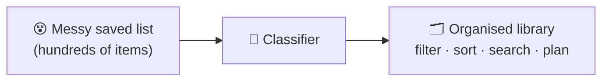

---

## 2. 🔭 What the system produces: the 7 lenses

Every saved item is viewed through **seven lenses**. Together they make up the item's "library card".

| # | Lens | What it answers | Example value |
|---|------|-----------------|---------------|
| 1 | **Topic** | What broad area is this? | `Retrieval-Augmented Generation (RAG)` |
| 2 | **Subtopic** | What exactly inside that area? | `Chunking strategies` |
| 3 | **Difficulty** | How much do I need to know already? | `Intermediate` |
| 4a | **Time to cover** | How long to read, watch or go through it once? | `25 min` |
| 4b | **Time to understand** | How long to really "get it" (practice, re-read, try it)? | `2 h` |
| 5 | **Content type** | What kind of thing is it? | `Tutorial` · `Mini-project` · `Full project` · `Interview Q set` · `News` · `Misc` |
| 6 | **AI Engineer alignment** | How useful is this for an AI Engineer? (0–10) | `8.5 / 10` |
| 7 | **Summary** | What is it about and why was it written? (1 paragraph) | *"A hands-on walkthrough of…"* |

<details>
<summary>🃏 <b>Click to see a complete example "library card"</b></summary>

```yaml
title:        "Stop using fixed-size chunks in your RAG pipeline"
source:       LinkedIn post by <author> · links to a blog article
topic:        Retrieval-Augmented Generation (RAG)
subtopic:     Chunking strategies
difficulty:   Intermediate
time_cover:   20 min
time_understand: 1 h 30 min
content_type: Tutorial
ai_engineer_alignment: 8.7 / 10
summary: >
  The post argues that naive fixed-size chunking hurts retrieval quality
  and walks through semantic and structure-aware chunking with code
  snippets in Python. The author's motive is educational, with a soft
  promotion of their newsletter. Useful for anyone tuning a RAG system.
confidence: 0.91   # how sure the system is
```
</details>

> [!TIP]
> Topics and subtopics come from a **fixed, editable list** (the *taxonomy*). The AI picks from that list instead of inventing new labels, so your library stays tidy and consistent.

> 🛠️ **Prototype note: what the lenses mean in the prototype.** All seven lenses are produced. Three of them have a different meaning from the table above:
> - **Time (4a, 4b):** the prototype times **the resource the post advertises** (a course, a repo, a guide), using only what the post says about its size, and falls back to the post's own reading time when the post says nothing. Each time carries a `basis` (`stated_in_post`, `estimated_from_post` or `post_only`). About 87% of the gold-set posts are `post_only`, so for most posts the time is a reading time plus a fixed hands-on allowance. No link is ever opened, so linked material is not measured.
> - **Confidence** is built differently (see §7.3) and does not yet separate good from bad labels well enough at the default threshold.
> - **Subtopic:** the taxonomy has 37 subtopics under 13 topics (plus "Other"), and neighbouring subtopics overlap, which limits accuracy (see §11).

---

## 3. 🎯 Goals and non-goals

### ✅ Goals
- **G1. Accurate**: labels match what a careful human would choose (target ≥ 85% topic accuracy on a test set).
- **G2. Consistent**: the same item always gets the same labels, drawn from a fixed vocabulary.
- **G3. Cheap**: classifying a few hundred items should cost about as much as a coffee, not a dinner.
- **G4. Private and local-first**: runs on your own laptop by default, and your data stays with you.
- **G5. Correctable**: you can fix wrong labels, and the system **learns from your fixes**.
- **G6. Extensible**: add new topics, new lenses or a new AI provider without rewriting the system.
- **G7. Useful output**: a dashboard plus exports to CSV, JSON, Markdown (Obsidian) and Notion.

### 🚫 Non-goals (v1)
- Not a LinkedIn clone or a feed reader.
- Not a multi-user SaaS product. It's built for **one person's own saved items**.
- 🔄 **No automated access to linkedin.com at all**, whether logged in or logged out: no bots, scrapers, auto-scrollers or automatic page saving. LinkedIn's User Agreement prohibits automated scraping. The only things that touch LinkedIn are things *you* do by hand (requesting the export, scrolling and saving your Saved page). See [§4.1](#41--getting-your-saved-posts-in-without-automating-linkedin).
- No video or audio transcription in v1 (planned as a later add-on).

> 🛠️ **Prototype note.** G3 and G4 hold completely (all models run locally, zero cost per post). G1 is not yet met for topic (57%) and subtopic (43%) on the 30-post test set; G2 holds (temperature 0, fixed answer lists, a cache key that changes when anything changes). G5 and G7 are the work of chats 3 and 4. The no-LinkedIn rule is respected by every script. A link fetcher for the pages that posts point to is deliberately not built.

---

## 4. 🗺️ The system at a glance

The system is a **pipeline**: items flow left to right through a series of stations, like an assembly line.

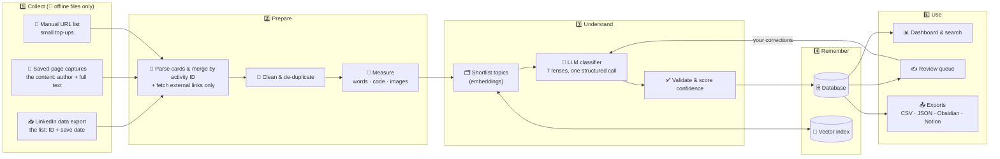

**In one sentence:** *collect* your saved items, *prepare* clean text, let an AI *understand* them against a fixed topic list, *remember* the results, and *use* them through a dashboard, a review screen and exports.

> 🛠️ **Prototype note: the pipeline as built.** Today the pipeline is: the export CSV and the saved-page captures are merged by activity ID into one file (`posts_with_save_dates.csv`) → the classifier reads that file → **two** local model calls per post (call A picks the subtopic from all 37 plus "Other"; call B fills in the remaining lenses) → the code validates the answers, does all the arithmetic and computes the confidence → one JSON line per post is written to a file. The stations that differ from the diagram: no manual list, no external-link fetching, no de-duplication, no shortlist (the whole taxonomy fits in the prompt), no database and no vector index (chat 3 adds SQLite), and no dashboard, review queue or exports yet (chats 3 and 4).

### 4.1 🆕 Getting your saved posts in, without automating LinkedIn

**The constraint:** LinkedIn has no API for saved items, and its User Agreement prohibits bots, scrapers and browser extensions that copy content. That covers logged-in *and* logged-out fetching, auto-scrolling and automatic screenshots or page saves. So the tool **never opens linkedin.com**. It works only on files you produce by hand.

**The solution: two files you create, joined by one number**

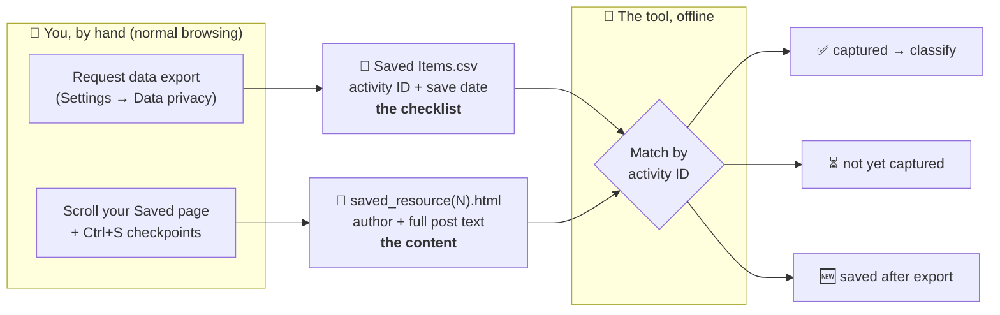

| Source | Gives you | Doesn't give you | Who touches LinkedIn |
|---|---|---|---|
| **Data export** (`Saved Items.csv`) | The **complete list** of saves: one URL per post and the **date you saved it** | Any content: no author, no text, no title | You (official LinkedIn feature) |
| **Saved-page captures** | Each post's **author, headline, full text, attached link title**, all inside a post "card" | Save dates; completeness (only what you scrolled past) | You (normal scrolling + Ctrl+S) |

**The shared key: the activity ID.** Every export URL looks like `linkedin.com/feed/update/urn:li:activity:7520913254760472576`. The long number is the post's ID. The same number is written on that post's card in the saved page. The tool cuts the number out of both **as plain text**, so no URL is ever opened.

**What we learned from real data**
- **All saved items are posts.** The export holds about 4,300 rows, all `feed/update/urn:li:activity:…` URLs. There are no article (`/pulse/`) URLs, and the URLs contain **no title words**, so a URL alone can't be classified.
- **The saved card holds the full post text** (up to about 3,000 characters), even though the screen shows "…see more".
- **The post's publish date is hidden in its ID.** It's decoded offline, so each post gets a *publish date* (from the ID) and a *save date* (from the export).
- **External articles are only reachable through the post.** A linked blog or repo appears as a link or attachment title in the post. Non-LinkedIn URLs may be fetched normally, but **`lnkd.in` short links are not followed automatically**, because that would be automated access to LinkedIn's link service.

**Partial runs are fine.** You don't have to capture all 4,300 posts before starting. Classify what's captured (e.g. the most recent year), and add older captures later: already-processed posts are cached and skipped, and new themes enter through the topic-growth step ([§7.4](#74--building-the-topic-list-from-your-own-data-phases-a--b--c), Phase C).

> 🛠️ **Prototype note.** This is exactly how the prototype's data was made, as a partial run: **674 posts** were captured by hand and merged with the export by two scripts (`parse_saved.py`, `merge_export.py`), giving `posts_with_save_dates.csv` with 673 posts that have text (one post is only an attachment title). The remaining export rows are "not yet captured". Of the 333 posts that contain links, 326 use `lnkd.in` and 7 are plain links, and 70 posts have an attachment title; none of these links is followed. Adding older captures later works as described: new posts are classified and the old ones are skipped by the cache.

---

## 5. 🧱 The building blocks

Click any block to expand it.

> 🛠️ **Prototype note: which blocks exist.** Built (as scripts): the capture and export collectors (blocks 1, offline files only), the classifier (block 6), the validator and confidence scorer (block 7), and the taxonomy discovery of §7.4. Built only in part: the extractor (block 2: post text only), the measurer (block 4: word count only). Not built yet: the cleaner and de-duplicator (block 3), the topic shortlister (block 5, not needed with 37 subtopics), storage (block 8: JSONL files for now, SQLite in chat 3) and the dashboard, review screen and exports (block 9: chats 3 and 4).

<details>
<summary><b>1️⃣ Collectors: getting your saved items in</b></summary>

🔄 LinkedIn has **no official API for saved items**, and automating linkedin.com breaks its terms. So every collector reads **files you made by hand**; none of them opens LinkedIn:

| Collector | How it works | Your effort | Risk |
|---|---|---|---|
| **Data export** (default: the list) | Reads `Saved Items.csv` from LinkedIn's "Download your data" archive: activity ID + save date for every saved post | A few clicks; up to 48 h wait | None |
| **Saved-page capture** (default: the content) | Reads the post cards from pages you saved with Ctrl+S while scrolling your Saved list | Scrolling by hand (once ~2–3 h for thousands of posts; minutes for top-ups) | None |
| **Manual list** (small top-ups) | A few URLs in a text or CSV file, e.g. posts saved after your last export | Low | None |

Every collector produces the same thing: a list of **"raw items"** keyed by **activity ID**, carrying a save date and/or captured text. Items with an ID but no text are kept as **"not yet captured"** rather than dropped.

> 🔄 The earlier "browser helper" (automated scrolling of the Saved page) has been **removed**. See [§4.1](#41--getting-your-saved-posts-in-without-automating-linkedin).
</details>

<details>
<summary><b>2️⃣ Extractor: getting clean text out</b></summary>

- **Posts:** author, post text, hashtags, and any attached link or document. 🔄 Read from the saved-page capture files (offline), not from LinkedIn.
- **Articles** 🔄 (external blogs, GitHub, docs **linked inside posts**): downloads the page and keeps only the main article text, dropping menus and ads. Only non-LinkedIn URLs are fetched; `lnkd.in` short links and `linkedin.com` pages are never opened automatically.
- **PDF carousels / documents:** extracts the text page by page.
- **Images and video:** v1 records that they exist (they count toward time estimates). v2 can add OCR and transcripts.
</details>

<details>
<summary><b>3️⃣ Cleaner and de-duplicator</b></summary>

- Removes tracking parameters from URLs and normalises whitespace and emojis.
- Creates a **fingerprint** of the content. If you saved the same thing twice, or a post and the article it links to, they are recognised and linked.
</details>

<details>
<summary><b>4️⃣ Measurer (enricher)</b></summary>

Counts things a computer can measure exactly: **word count, lines of code, number of images, PDF pages, video length**. These numbers anchor the time estimates, so the AI doesn't have to guess everything.
</details>

<details>
<summary><b>5️⃣ Topic shortlister</b></summary>

Turns the content and every topic description into **embeddings** (number fingerprints of meaning) and picks the ~5 closest topic/subtopic pairs. The AI then chooses from this short list, which is cheaper, faster and less likely to go wrong.
</details>

<details>
<summary><b>6️⃣ LLM classifier: the brain</b></summary>

One carefully designed prompt asks a large language model to fill in **all 7 lenses at once**, as strict JSON that matches a schema. It sees:
- the cleaned content,
- the measured numbers,
- the shortlisted topics,
- clear rules (rubrics) for difficulty, type and alignment,
- a few **examples you corrected before** (so it copies your judgement).

The model is **swappable** (Claude, OpenAI, or a local model via Ollama).
</details>

<details>
<summary><b>7️⃣ Validator and confidence scorer</b></summary>

Checks that the answer makes sense:
- Is the subtopic really inside the chosen topic?
- Is the time to understand ≥ the time to cover?
- Are the scores in range?

If something is wrong, it **retries once** with the error explained. Low-confidence results go to your **review queue** and are not accepted blindly.
</details>

<details>
<summary><b>8️⃣ Storage</b></summary>

- **Database** (SQLite by default, Postgres optional): items, content, classifications (with history), your corrections.
- **Vector index**: embeddings for topic shortlisting, "find similar" and semantic search.
</details>

<details>
<summary><b>9️⃣ Dashboard, review screen and exports</b></summary>

- **Dashboard:** filter by topic, difficulty, type and time; sort by AI-Engineer score; "plan my weekend" views.
- **Review queue:** fix labels in one click. Fixes feed back into the classifier.
- **Exports:** CSV, JSON, Markdown notes (Obsidian-friendly) and Notion.
</details>

---

## 6. 🚶 The life of one saved post

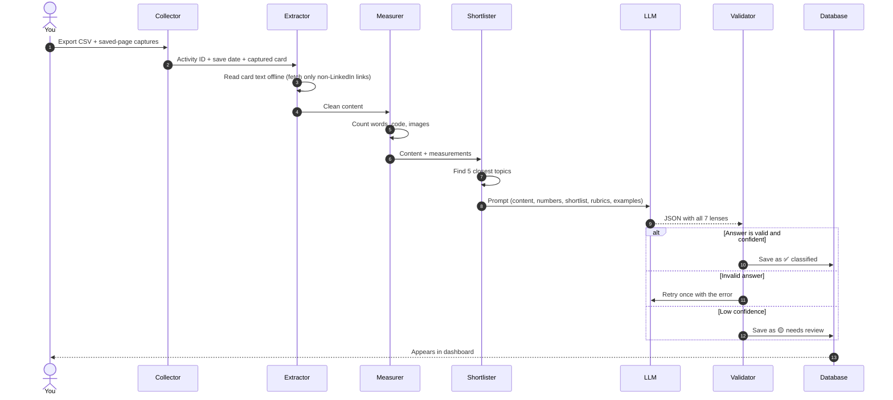

Each item also has a simple **status** so nothing gets lost, and a failed step can be resumed:

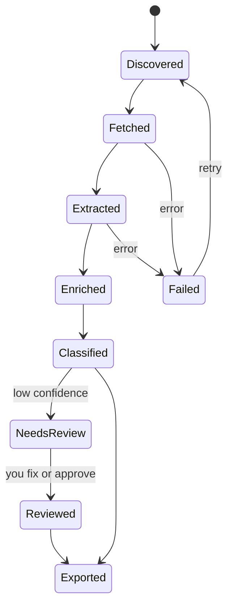

> 🛠️ **Prototype note.** In the prototype the "one structured call" is **two calls** (A: subtopic with an evidence quote, B: all other lenses), there is no shortlister and no database, and a post's progress is tracked by its line in the output file: a run that stops can be restarted and skips the posts already done (resume by cache key). A post that fails goes to a separate failures file. The status machine above arrives with SQLite in chat 3.

---

## 7. 🧠 How the "smart" part works

### 7.1 Topics are a tree (the taxonomy)

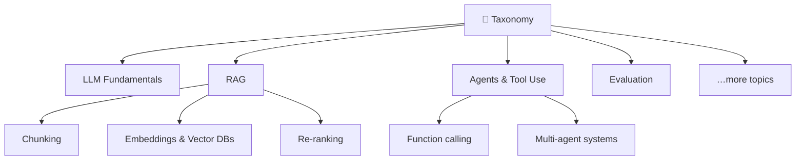

The tree lives in a simple editable file. Changing it creates a **new taxonomy version**, and the system knows which items were labelled with which version.

> [!IMPORTANT]
> You don't have to write this tree from scratch, or guess what you've saved. The first version is **discovered from your own saved items** and then approved by you. See [§7.4](#74--building-the-topic-list-from-your-own-data-phases-a--b--c).

> 🛠️ **Prototype note.** The tree above is an illustration. The real, frozen `taxonomy.v1` (fingerprint `3baa2b81d347`) has **13 topics and 37 subtopics** plus "Other" (43 posts). Largest topics: RAG (110 posts), LLM Architecture (105), AI Agent Development (102), AI Engineering Practices (77), Career Development (66). A change makes a new file (`taxonomy.v2.yaml`); results record the taxonomy fingerprint they were made with.

### 7.2 Each lens has a rule, not just a guess

| Lens | How it's decided |
|---|---|
| Topic / Subtopic | Embeddings shortlist, then the LLM picks from the shortlist |
| Difficulty | LLM, guided by a 4-level rubric (Beginner → Expert) with examples |
| Time to cover | **Mostly maths:** words ÷ reading speed + code + images + video length. The LLM can adjust it within limits |
| Time to understand | Time to cover × a depth factor (based on difficulty and type), then LLM sanity check |
| Content type | LLM, guided by clear decision rules (e.g. "has step-by-step instructions" → Tutorial) |
| AI-Engineer score | LLM scores **6 sub-criteria** (0–10 each), and a fixed weighted formula combines them |
| Summary | LLM, one paragraph covering *what* it says and *why* the author wrote it |

> [!NOTE]
> Splitting the alignment score into sub-criteria with a fixed formula makes it **explainable**: you can see *why* something scored 8.7 and not 6.

> 🛠️ **Prototype note: how each lens is decided today.**
> - **Topic / Subtopic:** the model picks one of the 37 subtopic ids (or "Other") through an answer list it cannot leave; the topic follows from the subtopic. No shortlist.
> - **Difficulty and content type:** model plus the written rubrics (`rubrics.v2.yaml`); the content-type rules are checked in order from the first.
> - **Time:** the model reports what the post states about the resource size (count and unit) and a rough estimate; **the code does all the arithmetic**, converting units (minute 1, hour 60, week 300, question 3 minutes) and applying fixed hands-on floors (tutorial 0, mini-project 45, full project 180 minutes). The "within limits" adjustment applies only when the post says nothing about the size.
> - **Alignment:** as designed: six sub-scores from the model, a weighted total computed in code.
> - **Summary:** one paragraph, judged in words (target 60 to 150, hard limits 30 to 220).

### 7.3 Confidence

Every result gets a **confidence score (0–1)** built from:
1. the model's own certainty,
2. whether the embedding shortlist and the LLM agree on the topic,
3. whether validation passed on the first try.

Results below the threshold (default 0.6) go to review.

> 🛠️ **Prototype note: confidence in practice.** The three parts are weighted 0.45 (model certainty), 0.35 (agreement) and 0.20 (validity). Because there is no shortlist, "agreement" is measured against the **clustering's subtopic** (1.0 same subtopic, 0.7 same topic, 0.4 otherwise); partial text counts ×0.7 and some warnings subtract 0.1. Measured on the gold set: the model's own certainty is nearly the same for every post, and with the default threshold of 0.6 almost nothing is sent to review. With `gemma`, a threshold of 0.9 sends about half of the posts to review and catches 13 of the 17 wrong subtopics. The threshold (or the formula) is therefore to be re-tuned on the full run in chat 3, together with the Review tab.

### 7.4 🔎 Building the topic list from your own data (Phases A → B → C)

**The problem:** if you don't yet know what you've saved, a topic list written up front is just a guess. Some topics will be empty, and others will be missing.

**The fix:** let your saved items *show* you the topics first, approve them, and only then classify against them.

```mermaid
flowchart LR
    subgraph A["🅰️ Phase A: Discover (one-time)"]
        A1["Collect & extract<br/>all items (no labels yet)"] --> A2["LLM writes 3–5 free-form<br/>keyphrases per item"]
        A2 --> A3["Embed & cluster<br/>similar items group together"]
        A3 --> A4["LLM names each cluster<br/>→ subtopics"]
        A4 --> A5["Group subtopics<br/>→ 8–15 parent topics"]
        A5 --> A6["✍️ You review the draft:<br/>merge · rename · split · delete"]
    end
    subgraph B["🅱️ Phase B: Freeze & classify"]
        B1["Save as taxonomy v1"] --> B2["Normal pipeline:<br/>constrained 7-lens classification"]
    end
    subgraph C["🅲 Phase C: Keep it alive"]
        C1["Items that don't fit<br/>→ 'Other'"] --> C2["Enough similar 'Other' items<br/>form a new cluster"]
        C2 --> C3["System proposes a new subtopic"]
        C3 --> C4["✅ You approve → taxonomy v2"]
    end
    A6 --> B1
    B2 --> C1
    C4 --> B2
```

| Phase | What happens | Your effort |
|---|---|---|
| **A: Discover** | The system reads everything, finds natural groups and drafts a topic tree **with item counts** per node | ~30–60 min reviewing the draft |
| **B: Freeze** | The approved tree becomes `taxonomy v1`. From here on, labels are consistent and filterable | None |
| **C: Evolve** | New themes are spotted automatically from the "Other" bucket and proposed for approval | A click now and then |

**Helpful details**
- **Hybrid start (recommended):** discovery can be *seeded* with a light starter list for AI Engineering. Clustering then adds what's missing, and seed topics with 0–1 items are pruned. This avoids oddly worded or lopsided purely data-driven topics, and also avoids a purely guessed list.
- **How many items you need:** clustering works well from about **100 items**. With fewer, start from the seed list and let Phase C grow it.
- **Keep it small:** at most ~15 topics with 2–6 subtopics each. Too many choices hurts accuracy and filtering.
- **Only topics are discovered.** Difficulty, content type, time and the AI-Engineer score have universal definitions, so their rubrics stay predefined.
- **Cost:** keyphrases come from one tiny LLM call per item. Clustering runs locally and is free.

> 🛠️ **Prototype note: Phases A and B as built (chat 1).** 673 posts → keyphrases from `qwen3` (about 30 minutes in total) → embeddings from the keyphrases only (`nomic-embed-text`, format words such as "interview" or "guide" removed so that subject, not format, drives the clusters) → UMAP and HDBSCAN with a second pass that rescues small real topics from the noise → **37 clusters** and 43 noise posts → topic list proposed by `gemma3:12b`, each cluster placed on a topic by `qwen3` through an answer list → **you edited the draft** (moved three clusters, added two topics) → `step5b_finalize.py` checked and froze `taxonomy.v1`. There was no seed list. **Phase C is not built**; the 43 posts in "Other" and the overlap between neighbouring subtopics are the open question for a possible v2.

---

## 8. 🔁 Keeping quality high: the feedback loop

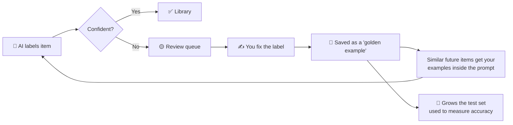

- **Learn by example:** your corrections are stored. When a *similar* new item arrives, the most similar corrections are shown to the AI as examples (few-shot learning). No model training is needed.
- **Measure, don't guess:** a small labelled test set (start with ~100 items) is used to score every change to prompts, models or the taxonomy *before* it's adopted.

> 🛠️ **Prototype note.** The "measure" half exists: a **30-post test set** labelled by you, with 19 labels questioned and re-decided in a review pass, and a script that scores any run against it (`step10_compare.py`). Every change in chat 2 (rubrics v2, the prompt version, model choice) was measured this way. The "learn" half (review queue, saved corrections, examples in the prompt) is not built: chat 3 builds the Review tab, chat 4 uses the corrections as examples.

---

## 9. 🏠 Where it runs

| Mode | Who it's for | Components |
|---|---|---|
| **Local (default)** | You, on your laptop | Python CLI + SQLite + local vector index + Streamlit dashboard. The LLM is either a cloud API or a local model (Ollama) |
| **Self-hosted server** | Always-on, phone access | Docker Compose: API + worker + Postgres (with pgvector) + dashboard, on a small VM |
| **Fully offline** | Maximum privacy | Same as local, with a local LLM and local embeddings. Slower, and a bit less accurate |

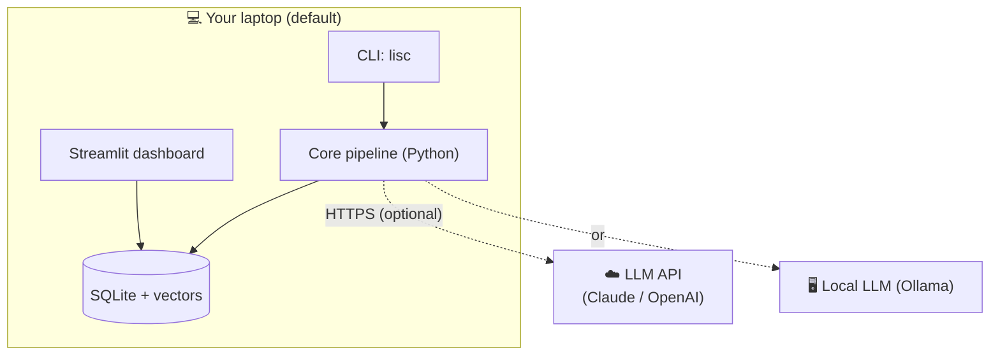

> 🛠️ **Prototype note.** The prototype runs in the **fully offline** mode: Windows laptop, PowerShell, a conda environment, Ollama on localhost. No cloud API, server mode or Docker is used or planned for chats 3 and 4.

### 9.1 🦙 Recommended fully local setup (Ollama)

**Fully local is the recommended default**: both the language model and the embedding model run on your machine through [Ollama](https://ollama.com), so your saved content never goes to an AI provider.

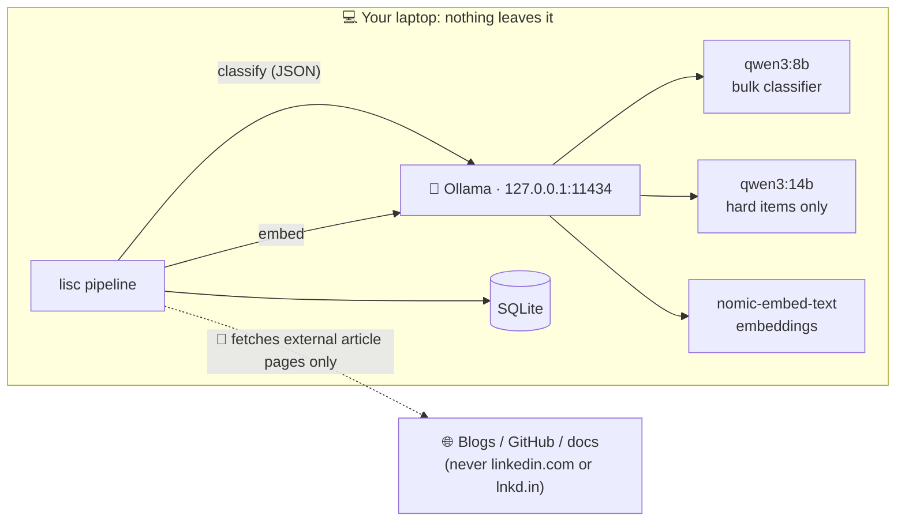

**Reference laptop:** 16 GB RAM · NVIDIA RTX GPU with **6 GB VRAM** · 512 GB SSD.

| Role | Model (Ollama) | Why |
|---|---|---|
| Bulk classifier ⭐ | `qwen3:8b` (~5 GB) | Best all-rounder at this size for JSON output and following rules. Runs almost entirely on a 6 GB GPU |
| Challenger | `gemma3:12b` (~8 GB) | Strong summaries and nuance; best non-Chinese option |
| Escalation (hard items) | `qwen3:14b` (~9 GB) | Highest quality that fits; slower (split between GPU and RAM), used for ~10–20% of items |
| Fast or light option | `qwen3:4b` / `gemma3:4b` (~3 GB) | Fully on the GPU, for speed |
| Embeddings ⭐ | `nomic-embed-text` (~0.3 GB) | Fast, good quality, long input. Upgrade option: `qwen3-embedding:0.6b` |

- **Why not newer Llama?** There's no newer Llama in the size a 6 GB GPU can run. Llama 4 models are far too large, and Llama 3.2 comes only in 1B and 3B sizes. Llama 3.1 8B still works, but Qwen3 and Gemma 3 are generally stronger at this size.
- **Many models, one active:** you can download several models (disk is the only cost). Ollama loads one on demand and unloads it after a few idle minutes. Process in **batches per model** so you don't swap models on every item.
- **Pick by evidence:** run the gold-set evaluation on ~50 items for each candidate and keep the winner.
- **Expected speed** (rough): `qwen3:8b` takes about 5–15 s per item on this laptop, so about 500 items in 1–2 hours. After that, only new items are processed.

> [!NOTE]
> **Local models have no tools or web access of their own.** A model file is a pure text generator. "Tool calling" support only means it can *request* a tool; an app must run it. The classifier is deliberately **tool-free**: the app fetches and cleans the content first, and the model only returns labels.

> 🛠️ **Prototype note: the models picked by evidence (chat 2).** Several models were run on the 30 gold posts with two calls per post. **`gemma4:e4b` won** and is approved for the full run: **13.5 s per post, about 2.5 hours for 673 posts**, 1 retry in 30 posts, content type 26 of 29 right, difficulty 30 of 30 within one level (17 exact), subtopic 13 of 30, topic 17 of 30. Others: `qwen3.5:4b` 18.5 s (the fallback; it needs `--presence-penalty 0`), `qwen3.5:9b` 71.1 s, `qwen3:latest` 65 to 96 s (it does not fit the 6 GB GPU well), `gemma4:12b` about 7.85 tokens per second (gold set only). The diagram's `qwen3:14b` escalation tier is not used. `qwen3` still does the keyphrases and cluster placement, `gemma3:12b` proposed the topic list once, and `nomic-embed-text` makes the embeddings. Before the long run, switch off sleep on the laptop.

---

## 10. ⚖️ Key design decisions

<details open>
<summary><b>Click to collapse the decision table</b></summary>

| Decision | Chosen | Alternatives considered | Why |
|---|---|---|---|
| How to classify | **LLM with structured (JSON-schema) output** | Train a custom ML classifier | No training data on day one. LLMs understand nuance, and the output schema keeps answers tidy |
| All 7 lenses in one call or seven calls? | **One call** (plus a cheap shortlist step) | One call per lens | 5–7× cheaper and faster, and the lenses inform each other (difficulty affects time) |
| Topic labels | **Fixed taxonomy, versioned** | Let the AI invent topics freely | Free-form labels drift ("RAG", "Retrieval Aug.", "RAG systems"…) and become unsortable |
| Time estimates | **Maths baseline + bounded AI adjustment** | Pure AI guess | AIs are poor at estimating time. Word counts are exact |
| Alignment score | **Weighted rubric of sub-scores** | Single 0–10 guess | Explainable, more stable, and the weights are tunable |
| Data collection 🔄 | **Data export (list) + saved-page captures you make by hand (content); no automated LinkedIn access** | Scraping bot; logged-in or logged-out page fetching; auto-scrolling browser helper | All automated options break LinkedIn's terms and put your real account at risk. By-hand capture is a one-time effort plus small top-ups |
| 🆕 How the two sources are joined | **Activity ID**, cut out of the export URL and read from each card's tag, as plain text | Matching by author or text | The ID is on both sides, unique per post, and needs no internet |
| 🆕 Post dates | **Decoded from the activity ID** (publish date) + export CSV (save date) | Parse "2d", "3mo" labels from cards | The ID is exact and offline; card labels are relative and vague |
| 🆕 Start before all posts are captured? | **Yes, run on what's captured** (e.g. the most recent year) | Wait for a complete capture | Value sooner; the cache and Phase C make later additions cheap |
| Storage | **SQLite → Postgres when needed** | Cloud DB from day one | Zero setup for one user, with an easy upgrade path |
| AI provider | **Pluggable adapter** | Hard-code one vendor | Prices and models change, and you can switch freely |
| Learning from corrections | **Few-shot retrieval of past fixes** | Fine-tuning a model | Instant, cheap, reversible, and needs no ML infrastructure |
| 🆕 Where the topic list comes from | **Discovered from your items (Phase A), approved, then frozen** | Write it fully by hand up front | You can't predict topics you haven't looked at. Discovery matches the list to reality, and freezing keeps labels consistent |
| 🆕 Default LLM and embeddings | **Local via Ollama** (`qwen3:8b` + `nomic-embed-text`) | Cloud API by default | Privacy first, free per item, and fits a 6 GB-VRAM laptop. Cloud remains a config switch |
| 🆕 Does the classifier get tools or web access? | **No, tool-free** | Give it search or fetch tools | Tools aren't needed (content is fetched beforehand), and without them a malicious post can at worst cause a wrong label |
</details>

> 🛠️ **Prototype note: decisions that changed or were added in the build.**
>
> | Decision | As built | Why |
> |---|---|---|
> | One call or seven? | **Two calls per post** (A: subtopic with an evidence quote; B: everything else) | A short, narrow first call is easier for a small model; still far cheaper than seven calls |
> | Topic choice | **All 37 subtopics in an enum, no shortlist** | The taxonomy fits in the prompt; clustering gives one subtopic, not a ranked list |
> | Time estimates | **Time of the resource the post advertises, from what the post states; code does the arithmetic** (user decision, 2026-11-09) | Models multiply badly; most posts state nothing, so `post_only` is common and honest |
> | Default LLM | **`gemma4:e4b`** for the full run (fallback `qwen3.5:4b`), chosen by measurement | Fastest of the models that scored well; replaces `qwen3:8b` as the planned default |
> | Rubrics | **v2** (`fdab10ef08be`), v1 kept for traceability | Three targeted fixes after the first gold-set run |
> | Dashboard | **Full dashboard is the main deliverable; four chats in total** (user decision) | The library is only useful if it can be browsed, reviewed and planned from |
> | Link fetching | **None for now** | 326 of 333 posts with links use `lnkd.in`, which must never be followed |

---

## 11. 📐 Quality attributes

| Attribute | Target (v1) | How we get there |
|---|---|---|
| **Accuracy** | Topic ≥ 85%, Subtopic ≥ 70%, Difficulty within ±1 level ≥ 90%, Alignment error ≤ 1.5 points | Shortlisting, rubrics, few-shot corrections, evaluation set |
| **Cost** | ~2–4k tokens per item, about one cheap-model call | One call per item, shortlist, caching, batch APIs |
| **Speed** | ~500 items in < 15 min (cloud LLM) | Parallel workers with rate limits |
| **Re-runs** | Unchanged items cost **zero** | Cache keyed on *content + prompt version + model + taxonomy version* |
| **Privacy** | Data never leaves your machine except the LLM call (and not even that in offline mode) | Local-first design, secrets in `.env` |
| **Reliability** | No item silently lost | Status machine, retries, resumable runs, run logs |
| **Explainability** | Every label has a reason | Model returns short rationales and sub-scores |

> 🛠️ **Prototype note: where the prototype stands against the targets.** Measured on the 30 gold posts with `gemma4:e4b` and your reviewed labels.
>
> | Attribute | Target | Measured | Status |
> |---|---|---|---|
> | Topic accuracy | ≥ 85% | 17 of 30 (57%) | below |
> | Subtopic accuracy | ≥ 70% | 13 of 30 (43%) | below |
> | Difficulty within ±1 | ≥ 90% | 30 of 30 (100%), exact 17 of 30 | met |
> | Content type | ≥ 85% | 26 of 29 (90%) | met |
> | Alignment error | ≤ 1.5 | not measured (no labels) | open |
> | Review rate | ≤ 25% | the default rule flags almost nothing; a stricter threshold flags about half | open (§7.3) |
> | Speed | < 15 min for 500 items (cloud) | local: 13.5 s per post, about 2.5 h for 673 | different premise |
> | Cost | about one cheap call | two local calls, no money cost | met |
> | Re-runs | unchanged items cost zero | cache key plus resume work | met |
> | Privacy | nothing leaves the machine | fully local | met |
>
> **Reading the numbers with care:** the test set is small (30), and some fixes were chosen after looking at these same posts, so the figures are optimistic. Seven of the thirty posts are never right in any run, which points at overlapping subtopics in the taxonomy rather than at the models. Whether to rework the taxonomy (v2) is an open decision for chat 3.

---

## 12. 🛡️ Risks and how we handle them

| Risk | Impact | Mitigation |
|---|---|---|
| LinkedIn changes its page layout 🔄 | The capture parser stops finding cards | Card selectors live in one small config file; the export CSV still lists every item, so nothing is silently lost |
| LinkedIn terms of service 🔄 | Account restrictions | No automated access to linkedin.com at all; only by-hand export and Ctrl+S captures |
| Article behind a paywall or login | Thin content, so weaker labels | Classify from post text only, flag `partial_content`, lower confidence |
| 🆕 Capture incomplete (didn't scroll far enough) | Older saves have no content | The export CSV shows exactly which IDs are missing ("674 of 4,300 captured"); capture more later |
| 🆕 Browser tab crashes during a long scroll | Lost scrolling effort | Checkpoint saves every few hundred posts (each is cumulative); block images to save memory |
| 🆕 Post deleted by its author | In the export, but never appears on the Saved page | Shown as "saved but unavailable" after the capture reaches the bottom |
| 🆕 Links hidden behind `lnkd.in` | The linked article can't be read | Classify from the post text + attachment title; you can open the link yourself if needed |
| LLM "hallucinates" a topic | Wrong label | Restricted choices (enum), validation, retry, review queue |
| Taxonomy grows stale | Many items land in "Other" | "Other" rate tracked in the dashboard, with suggested new subtopics from clusters |
| Model or price changes | Cost or quality drift | Provider adapter plus evaluation set run before switching |
| Very long articles | High cost | Smart truncation: intro, headings, code samples and conclusion |
| 🆕 Topic list guessed wrong at the start | Empty topics, missing themes | Phase A discovery from your data + Phase C evolution |
| 🆕 "Local = 100% private" assumed blindly | Leaks via an exposed Ollama port, Ollama cloud models, synced folders or a stolen laptop | Local privacy checklist (README): bind to `127.0.0.1`, local models only, keep `data/` out of synced folders, enable disk encryption |
| 🆕 Smaller local models judge less finely | Slightly weaker difficulty and score labels | Escalate low-confidence items to `qwen3:14b`, use few-shot corrections, compare models on the gold set |

> 🛠️ **Prototype note: risks seen in practice (chat 2).**
>
> | Risk | What happened | Handling |
> |---|---|---|
> | Overlapping subtopics | 7 of 30 gold posts are never right in any run; neighbours such as the agent subtopics overlap | Open decision on a taxonomy v2; the Review tab collects corrections |
> | Confidence does not separate good from bad | The default threshold flags almost nothing | Re-tune on the full run (chat 3) |
> | Over-optimistic test numbers | 30 posts, fixes chosen after seeing them | Larger test set from the Review tab corrections |
> | Stalled model call | One call hung for about 22 minutes, most likely the laptop sleeping; there is no per-call timeout | Switch off sleep for long runs; add a timeout (open item) |
> | Time estimates rest on thin information | About 87% of gold posts say nothing about the resource size | Honest `basis` stored per result; a link fetcher is out of scope for now |
> | Repeated reposts inflate clusters | No de-duplication yet | Open item; each repost is classified on its own |
> | Local model quirks | `qwen3.5` models need `--presence-penalty 0`; `ollama ps` under-reports Gemma 4 memory | Documented; options stored in the cache key |

---

## 13. 🛣️ Delivery roadmap

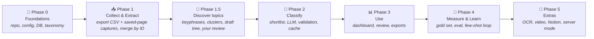

| Phase | Done when… |
|---|---|
| 0 | `lisc init` creates config, DB and the default taxonomy |
| 1 | 🔄 Export CSV and saved-page captures merged by activity ID; captured posts stored with clean text and a coverage report |
| 1.5 | A discovered draft taxonomy has been reviewed by you and frozen as `v1` |
| 2 | 🔄 The captured posts have all 7 lenses filled, valid, and cached |
| 3 | You can filter, sort, review and export in the dashboard |
| 4 | Accuracy numbers are reported for every prompt or model change |
| 5 | Optional extras, one at a time |

> 🛠️ **Prototype note: where each phase stands, and how it maps to the four chats (2026-11-12).**
>
> | Phase | Status | Chat |
> |---|---|---|
> | 0 Foundations | Not as designed: no `lisc init`, config file or database. Scripts, rubrics and taxonomy files, tests and CI exist | chat 3 adds SQLite; the `lisc` package layout is left for later |
> | 1 Collect & Extract | Done for posts as scripts (export plus captures merged by activity ID, 674 posts); no extractors beyond post text, no de-duplication | done before the classifier work |
> | 1.5 Discover topics | **Done**: reviewed by you and frozen as `v1` (13 topics, 37 subtopics) | chat 1 |
> | 2 Classify | **Prototype done**: rubrics v2, two-call classifier, validation, scoring, cache and resume; the full 673-post run is next | chat 2 built it; chat 3 runs it on all posts |
> | 3 Use | Not started | chat 3: SQLite loader, Library and Review tabs, CSV and JSON export; chat 4: Planner, Insights, Runs, Obsidian and Notion |
> | 4 Measure & Learn | Partly: a 30-post test set and a scoring script exist; no few-shot loop | chats 3 and 4: corrections from the Review tab become examples and a larger test set |
> | 5 Extras | Not started, and mostly not planned (a link fetcher, server mode, OCR, video) | later |
>
> **Chat 3 (Steps 13 to 18)** and **chat 4** are described in `design/handoff-chat-2-to-3.md`. Chat 4 ends with the final checks and a last alignment of these design documents.

---

## 14. 📖 Glossary

| Term | Meaning |
|---|---|
| **LLM** | Large Language Model, the AI (e.g. Claude) that reads and labels content |
| **Taxonomy** | The fixed tree of topics and subtopics |
| **Embedding** | A list of numbers capturing the *meaning* of text. Similar meaning gives nearby numbers |
| **Shortlist** | The top few topics picked by embeddings before the LLM decides |
| **Structured output** | Making the LLM answer in strict JSON that matches a schema |
| **Few-shot** | Showing the LLM a few solved examples inside the prompt |
| **Rubric** | A written scoring guide (what "Advanced" means, what a 9/10 means) |
| **Confidence** | How sure the system is about a label (0–1) |
| **Gold set** | Items labelled by you, used as the answer key to measure accuracy |
| **Cache key** | A fingerprint that tells the system "I've already done exactly this, so skip it" |
| **Taxonomy discovery** | Building the first topic list by grouping your actual saved items (Phase A) |
| **Clustering** | Automatically grouping items whose embeddings are close together |
| **Ollama** | A free app that runs open-source LLMs and embedding models on your own computer |
| **VRAM** | Your graphics card's memory. Models that fit in it run much faster |
| **Tool calling** | A model *asking* an app to run something (search, fetch). The model can't run it itself |
| **Activity ID** | The long number in a LinkedIn post URL (`urn:li:activity:…`). Unique per post; links the export CSV to the captured content, and contains the post's publish date |
| **Export CSV** | `Saved Items.csv` from LinkedIn's data download: one row per saved post (URL + save date), no content |
| **Saved-page capture** | A copy of your Saved posts page that you make with Ctrl+S while scrolling. Its frame file `saved_resource(N).html` holds the post cards |
| **Coverage** | How many export rows have captured content, e.g. "674 of 4,300" |

> 🛠️ **Prototype note: terms used in the build.**
>
> | Term | Meaning |
> |---|---|
> | **Basis** | Where a time estimate comes from: `stated_in_post`, `estimated_from_post` or `post_only` |
> | **Rubrics fingerprint** | Short hash of the rubrics file (v2 is `fdab10ef08be`); part of the cache key |
> | **Taxonomy fingerprint** | Short hash of the frozen taxonomy (v1 is `3baa2b81d347`) |
> | **Prompt version** | Label of the prompt text (now `classify-2026.11.3`) |
> | **JSONL** | A text file with one JSON record per line; the prototype's output format |
> | **Mutation check** | A test-of-the-tests: change the code on purpose and confirm the tests fail |

---

<p align="center">➡️ Next: read the <a href="./LLD.md"><b>Low-Level Design</b></a> for classes, schemas, prompts and algorithms, or the <a href="./README.md"><b>README</b></a> to get started.</p>
