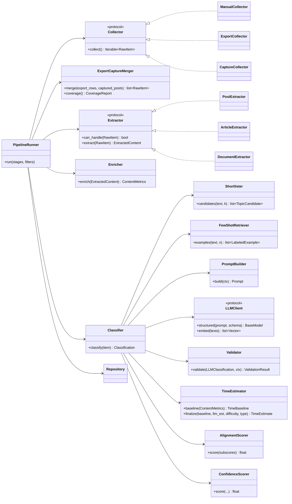
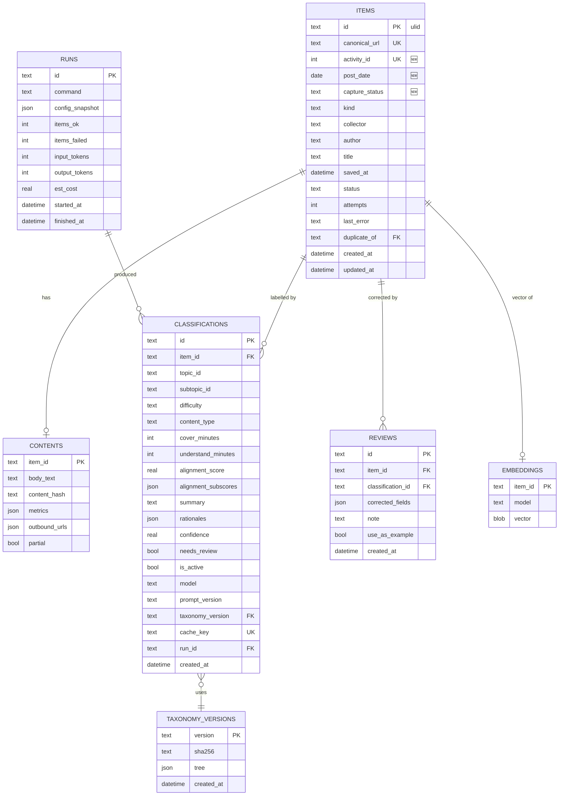
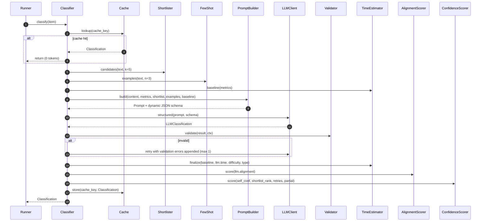
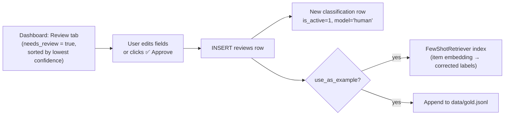
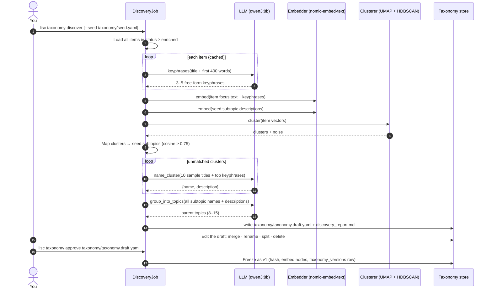
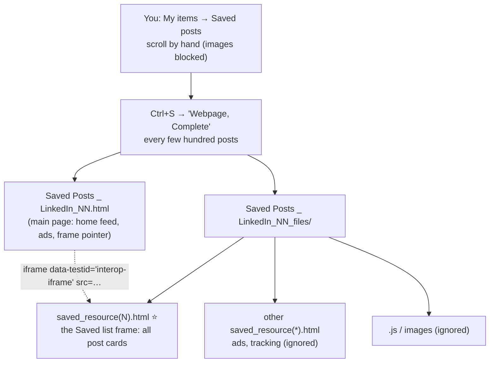
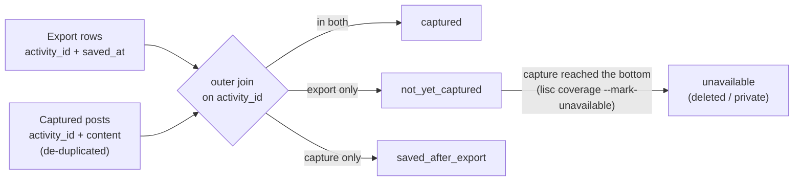
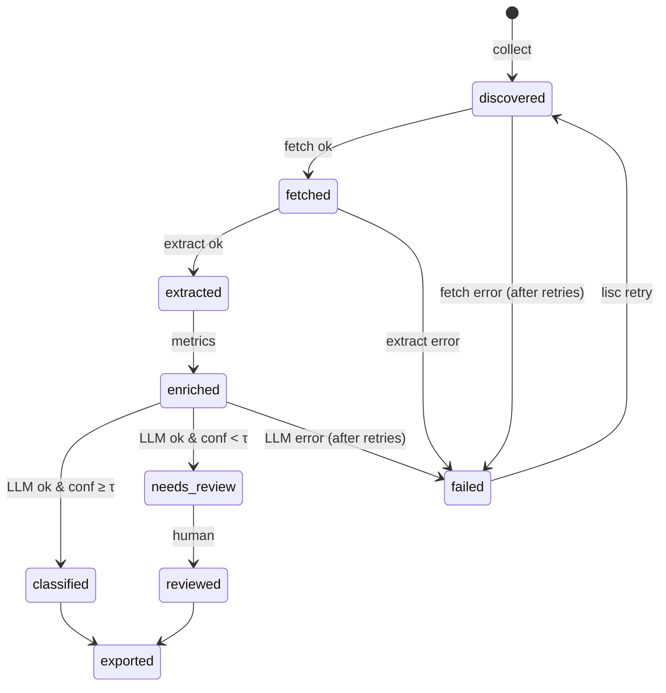
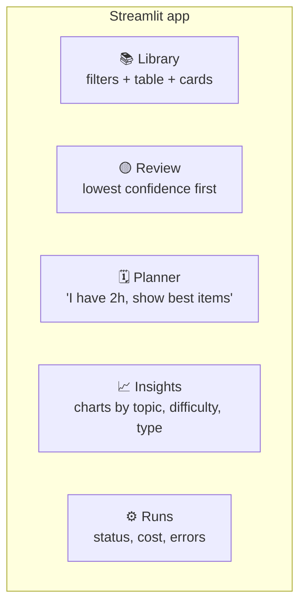

# 🔧 Low-Level Design (LLD)
## LinkedIn Saved Content Classifier

> This document turns the [HLD](./HLD.md) into something you can build: the tech stack, folder layout, classes, data schemas, database tables, prompts, algorithms, error handling, testing and the build checklist.
>
> 💡 **How to read it:** every major section starts with a short **"In simple terms"** line. Code blocks show the *shape* of the implementation, not the final code. Expand the ▶ sections for full detail.

| | |
|---|---|
| **Version** | 1.0 (matches HLD v1.0) |
| **Language** | Python 3.11+ |
| **CLI name** | `lisc` (**Li**nkedIn **S**aved **C**lassifier) |

> 🛠️ **Prototype status (2026-11-12, end of chat 2 of 4).** This document describes the **target product**. What exists so far is a working prototype of the classification core, built as standalone scripts under `pipeline/` (keyphrases, embeddings, clustering and taxonomy in steps 2 to 5b; rubrics, the 7-lens classifier, the gold set and the model comparison in steps 8 to 11), writing JSONL files instead of a database, with no `lisc` command yet. Blocks marked **🛠️ Prototype note** say where the build differs from the text around them. The original design text is left unchanged so intent and build can be compared. The full record is `design/project-log.md` (section 5 lists the deviations, section 3 gives the reasons and measurements).
>
> **Plan:** chat 3 adds the full 673-post run, a SQLite loader and the Library and Review tabs of the dashboard, plus CSV and JSON exports; chat 4 adds the Planner, Insights and Runs tabs, the Obsidian and Notion exports and a last alignment of these documents. In the project knowledge base this LLD is kept as two files (sections 1 to 8 and sections 9 to 22); in the repository it is the single file `LLD.md`.

---

### 📑 Table of Contents
1. [Tech stack](#1-tech-stack)
2. [Repository layout](#2-repository-layout)
3. [Component and class diagram](#3-component-and-class-diagram)
4. [Data models (Pydantic)](#4-data-models-pydantic)
5. [Database schema](#5-database-schema)
6. [Taxonomy file format](#6-taxonomy-file-format)
7. [Module designs](#7-module-designs)
   - 7.1 [Collectors](#71-collectors) · 7.2 [Extractors](#72-extractors) · 7.3 [Normaliser and dedup](#73-normaliser-and-dedup) · 7.4 [Enricher](#74-enricher) · 7.5 [Shortlister](#75-shortlister) · 7.6 [Classifier](#76-classifier-orchestrator) · 7.7 [LLM adapter](#77-llm-provider-adapter) · 7.8 [Validator](#78-validator) · 7.9 [Review and feedback](#79-review-and-feedback) · 7.10 [Exporters](#710-exporters) · 7.11 [🆕 Taxonomy discovery](#711-taxonomy-discovery-phases-a--b--c) · 7.12 [🆕 Saved-page capture and merge](#712-saved-page-capture-and-merge)
8. [Prompt design](#8-prompt-design)
9. [Algorithms](#9-algorithms)
10. [Pipeline orchestration, concurrency and caching](#10-pipeline-orchestration-concurrency-and-caching)
11. [Error handling](#11-error-handling)
12. [Configuration](#12-configuration)
13. [Interfaces: CLI and optional REST API](#13-interfaces-cli-and-optional-rest-api)
14. [Dashboard design](#14-dashboard-design)
15. [Evaluation framework](#15-evaluation-framework)
16. [Observability](#16-observability)
17. [Testing strategy](#17-testing-strategy)
18. [Cost model](#18-cost-model)
19. [Security, privacy and compliance](#19-security-privacy-and-compliance)
20. [Extension points](#20-extension-points)
21. [Build checklist](#21-build-checklist)
22. [🆕 Local LLM runtime (Ollama)](#22-local-llm-runtime-ollama)

---

## 1. Tech stack

> **In simple terms:** boring, well-known Python tools that run on a laptop.

| Concern | Choice | Why / Notes |
|---|---|---|
| Language | **Python 3.11+** | Best ecosystem for LLM and text work |
| Packaging | **uv** (or Poetry) | Fast, reproducible installs |
| CLI | **Typer** + **Rich** | Typed commands, pretty progress bars |
| Data models | **Pydantic v2** | Validation and JSON schema generation for LLM structured output |
| Config | **pydantic-settings** + YAML | `.env` for secrets, `config.yaml` for behaviour |
| DB / ORM | **SQLAlchemy 2.x** + **Alembic** | SQLite by default, Postgres with a URL change |
| Vectors | **sqlite-vec** (local) / **pgvector** (server) | Same interface behind a `VectorStore` protocol |
| HTTP | **httpx** (async) + **tenacity** | Async fetch with retry and back-off |
| Article extraction | **trafilatura** (fallback: readability-lxml) | High-quality main-text extraction |
| PDFs | **PyMuPDF** (`fitz`) | Fast text and page counts |
| Capture parsing 🔄 | **BeautifulSoup** + **lxml** | Reads the saved-page frame files (`saved_resource(N).html`) offline. Replaces the earlier Playwright browser helper, which automated LinkedIn |
| Embeddings | **Ollama `nomic-embed-text`** (default), or sentence-transformers (`bge-small-en-v1.5`) / provider API | Local, free and fast by default |
| LLM | Provider adapter: **Ollama** (default: `qwen3:8b`), **Anthropic**, **OpenAI** | Native structured or tool output, all behind one interface |
| Clustering (discovery) | **UMAP** + **HDBSCAN** (or BERTopic, which wraps both) | Finds natural topic groups in your saved items |
| Token counting | Provider count endpoint or `len(text)/4` heuristic | Only used for truncation budgeting |
| Dashboard | **Streamlit** | Fastest route to a usable UI |
| Optional API | **FastAPI** | For server mode or integrations |
| Tests | **pytest**, **pytest-asyncio**, **respx**, **hypothesis** | Unit, contract and property tests |
| Lint / types | **ruff**, **mypy** (strict on `core/`) | |
| Tracing (optional) | **OpenTelemetry** / **Langfuse** | LLM call traces and cost |

> 🛠️ **Prototype note.** In use today: Python 3.11 in a conda environment (`lisc_env`), Ollama over plain HTTP through one small helper (`pipeline/ollama_json.py`, structured JSON output), `nomic-embed-text` for embeddings, UMAP plus **scikit-learn's `HDBSCAN`** (not the separate `hdbscan` package, to save a dependency), PyYAML for the taxonomy and rubrics files, pandas and numpy for data, `beautifulsoup4` and `lxml` for the two ingestion scripts, and pytest (with mutation checks written as plain Python scripts in `tools/`). One `requirements.txt` serves both running and testing. Not used yet: Typer/Rich, SQLAlchemy/Alembic, sqlite-vec, Streamlit (chat 3 adds SQLite and Streamlit), FastAPI, httpx/tenacity, trafilatura, PyMuPDF. Each prototype script has its own small command line.

---

## 2. Repository layout

```text
linkedin-saved-classifier/
├── pyproject.toml
├── .env.example                  # API keys (never committed)
├── config.yaml                   # behaviour settings
├── taxonomy/
│   ├── seed.yaml                 # 🆕 starter list used to seed discovery
│   ├── taxonomy.draft.yaml       # 🆕 output of `lisc taxonomy discover` (you edit this)
│   ├── taxonomy.v1.yaml          # topic → subtopic tree (approved, active)
│   └── rubrics.yaml              # difficulty / type / alignment rubrics
├── prompts/
│   ├── classify.system.j2        # Jinja2 templates, versioned
│   ├── classify.user.j2
│   └── VERSION                   # e.g. "classify-2026.10.1"
├── src/lisc/
│   ├── __init__.py
│   ├── cli.py                    # Typer entry point
│   ├── settings.py               # pydantic-settings
│   ├── core/
│   │   ├── models.py             # Pydantic domain models
│   │   ├── enums.py
│   │   ├── taxonomy.py           # load / validate / version / hash taxonomy
│   │   └── errors.py
│   ├── collect/
│   │   ├── base.py               # Collector protocol
│   │   ├── manual.py             # URLs / CSV (small top-ups)
│   │   ├── export.py             # LinkedIn data-export archive (the list: ID + save date)
│   │   ├── capture.py            # 🆕 saved-page frame files (the content); replaces browser.py
│   │   └── merge.py              # 🆕 join export + captures by activity ID, coverage report
│   ├── extract/
│   │   ├── base.py
│   │   ├── post.py
│   │   ├── article.py
│   │   └── document.py           # PDF carousels
│   ├── normalize/
│   │   ├── cleaner.py
│   │   └── dedup.py
│   ├── enrich/
│   │   └── metrics.py            # words, code lines, images, video secs
│   ├── classify/
│   │   ├── discovery.py          # 🆕 Phase A: keyphrases → clusters → draft taxonomy
│   │   ├── shortlist.py          # embedding-based topic candidates
│   │   ├── prompt_builder.py
│   │   ├── fewshot.py            # retrieve similar corrected examples
│   │   ├── classifier.py         # orchestrator
│   │   ├── validator.py
│   │   ├── time_estimator.py
│   │   ├── alignment.py
│   │   └── confidence.py
│   ├── llm/
│   │   ├── base.py               # LLMClient protocol
│   │   ├── anthropic_client.py
│   │   ├── openai_client.py
│   │   ├── ollama_client.py
│   │   └── embeddings.py
│   ├── store/
│   │   ├── db.py                 # engine / session
│   │   ├── tables.py             # SQLAlchemy models
│   │   ├── repositories.py
│   │   └── vectors.py            # VectorStore protocol + impls
│   ├── pipeline/
│   │   ├── runner.py             # stage scheduler, state machine
│   │   ├── stages.py
│   │   └── cache.py
│   ├── review/
│   │   └── feedback.py
│   ├── export/
│   │   ├── csv_json.py
│   │   ├── obsidian.py
│   │   └── notion.py
│   ├── eval/
│   │   ├── gold.py
│   │   └── metrics.py
│   ├── api/                      # optional FastAPI
│   │   └── app.py
│   └── ui/
│       └── dashboard.py          # Streamlit
├── migrations/                   # Alembic
├── scripts/                      # 🆕 parse_saved.py, merge_export.py (reference implementations, §7.12)
├── data/                         # local DB, gold set, exports, captures/ (git-ignored)
└── tests/
    ├── unit/  ├── contract/  ├── integration/  └── fixtures/
```

> 🛠️ **Prototype note: the layout that exists today.** The package `src/lisc/` has not been created. The prototype is a flat set of scripts, and the folder names differ from the tree above (`pipeline/` and `input-data/` instead of `src/lisc/` and `data/`). When the real package is built in chats 3 and 4, the scripts move into modules and this tree applies again.
>
> ```text
> repo/
> ├── pipeline/            # step scripts and their helpers
> │   ├── ollama_json.py   # structured-output call to Ollama
> │   ├── step2 to step5   # keyphrases, embeddings, clustering, taxonomy draft (chat 1)
> │   ├── step5b_finalize.py        # validates and freezes the taxonomy
> │   ├── rubrics.py       # loads, validates and fingerprints the rubrics file
> │   ├── scoring.py       # all arithmetic: time, alignment score, buckets
> │   ├── classify_inputs.py        # reads and checks taxonomy, assignments, posts
> │   ├── classifier.py    # prompts, answer checks, confidence, cache key, classify_post
> │   ├── step9_classify.py         # command line: classify posts into a JSONL file
> │   ├── step10_gold_sample.py     # picks the 30 gold posts, writes the labelling sheet
> │   ├── step10_gold_labels.py     # reads the filled sheet
> │   ├── step10_compare.py         # scores any run against the gold labels
> │   └── taxonomy/                 # taxonomy.v1.yaml (the only committed file here) and the assignments file
> ├── input-data/          # posts_with_save_dates.csv (the merged export + captures)
> ├── rubrics/             # rubrics.v1.yaml (untouched), rubrics.v2.yaml (default)
> ├── tests/               # at the repo root; 771 tests expected
> ├── tools/               # mutation-check scripts (not run by CI)
> ├── gold/                # hand-labelled posts and run files (git-ignored: holds post text)
> └── .github/workflows/tests.yml    # runs pytest on every pull request
> ```
>
> Not committed by design: `*.jsonl`, embeddings, cluster files, everything in `pipeline/taxonomy/` except `taxonomy.v1.yaml`, and `gold/`. The two ingestion scripts (`parse_saved.py`, `merge_export.py`) are not yet committed either.

---

## 3. Component and class diagram

> **In simple terms:** each box is a Python class. Arrows show "uses".



> 🛠️ **Prototype note.** The prototype has no class hierarchy: `scoring.py` plays the part of `TimeEstimator`, `AlignmentScorer` and the bucket logic; `classifier.py` holds the prompt building, the validator, the `ConfidenceScorer` and the `Classifier` orchestrator as functions; `classify_inputs.py` replaces the collectors for the one input file; and there is no `Shortlister`, `FewShotRetriever` or `PipelineRunner` (a loop in `step9_classify.py` does the runner's job).

---

## 4. Data models (Pydantic)

> **In simple terms:** these are the "shapes" of data passed between stations. The `LLMClassification` model doubles as the JSON schema the AI must fill in.

<details open>
<summary><b>📦 <code>core/enums.py</code></b></summary>

```python
from enum import StrEnum

class SourceKind(StrEnum):
    POST = "post"
    ARTICLE = "article"            # LinkedIn Pulse or external
    DOCUMENT = "document"          # PDF / carousel
    UNKNOWN = "unknown"

class Difficulty(StrEnum):
    BEGINNER = "beginner"
    INTERMEDIATE = "intermediate"
    ADVANCED = "advanced"
    EXPERT = "expert"

class ContentType(StrEnum):
    TUTORIAL = "tutorial"
    MINI_PROJECT = "mini_project"
    FULL_PROJECT = "full_project"
    INTERVIEW_QUESTIONS = "interview_question_set"
    NEWS = "news"
    MISC = "miscellaneous"

class ItemStatus(StrEnum):
    DISCOVERED = "discovered"
    FETCHED = "fetched"
    EXTRACTED = "extracted"
    ENRICHED = "enriched"
    CLASSIFIED = "classified"
    NEEDS_REVIEW = "needs_review"
    REVIEWED = "reviewed"
    EXPORTED = "exported"
    FAILED = "failed"

class CaptureStatus(StrEnum):              # 🆕 result of the export ↔ capture merge (§7.12)
    CAPTURED = "captured"                  # in export and in captures → classify
    NOT_YET_CAPTURED = "not_yet_captured"  # in export only → scroll further / re-check
    SAVED_AFTER_EXPORT = "saved_after_export"  # in captures only → saved after export date
    UNAVAILABLE = "unavailable"            # still missing after capture reached the bottom
```
</details>

<details open>
<summary><b>📦 <code>core/models.py</code>: pipeline models</b></summary>

```python
from datetime import date, datetime
from pydantic import BaseModel, Field, HttpUrl

class RawItem(BaseModel):
    source_url: HttpUrl
    collector: str                          # 🔄 "export" | "capture" | "manual"
    activity_id: int | None = None          # 🆕 join key, from "urn:li:activity:<ID>"
    saved_at: datetime | None = None        # from the export CSV
    post_date: date | None = None           # 🆕 publish date, decoded from activity_id
    captured_text: str | None = None        # full post text from the saved-page card
    author: str | None = None
    author_headline: str | None = None      # 🆕
    attachment_title: str | None = None     # 🆕 link-preview title (article, repo, ...)
    attachment_site: str | None = None      # 🆕 e.g. "github.com"
    capture_status: CaptureStatus = CaptureStatus.CAPTURED   # 🆕 see §7.12

class ExtractedContent(BaseModel):
    item_id: str
    kind: SourceKind
    title: str | None
    author: str | None
    body_text: str                          # cleaned main text
    outbound_urls: list[str] = []
    code_blocks: list[str] = []
    image_count: int = 0
    video_seconds: int | None = None
    pdf_pages: int | None = None
    partial: bool = False                   # True if paywalled / truncated / login-walled
    content_hash: str                       # sha256 of normalised body_text

class ContentMetrics(BaseModel):
    word_count: int
    code_lines: int
    image_count: int
    video_seconds: int
    pdf_pages: int
    has_math: bool
    link_count: int
    est_tokens: int

class TopicCandidate(BaseModel):
    topic_id: str
    subtopic_id: str
    label: str                              # "RAG › Chunking"
    similarity: float
```
</details>

<details open>
<summary><b>📦 <code>core/models.py</code>: the LLM output schema (the heart of the system)</b></summary>

```python
from typing import Literal

class AlignmentSubscores(BaseModel):
    """Each 0–10. Combined by a fixed weighted formula (see §9.4)."""
    applicability: int = Field(ge=0, le=10, description="Directly usable when building LLM/AI apps")
    technical_depth: int = Field(ge=0, le=10)
    hands_on: int = Field(ge=0, le=10, description="Code, exercises, buildable steps")
    currency: int = Field(ge=0, le=10, description="Modern, still-relevant tools and practices")
    career_value: int = Field(ge=0, le=10, description="Interviews, portfolio, positioning")
    production_relevance: int = Field(ge=0, le=10, description="Scale, reliability, cost, evals, ops")

class LLMTimeEstimate(BaseModel):
    cover_minutes: int = Field(ge=1, le=60*24*14)
    understand_minutes: int = Field(ge=1, le=60*24*30)
    rationale: str = Field(max_length=300)

class LLMClassification(BaseModel):
    """Schema sent to the LLM. Field ORDER matters: reasoning-ish fields come first."""
    key_points: list[str] = Field(min_length=1, max_length=5,
        description="Short bullets of what the content actually covers")
    topic_id: str                           # constrained to shortlist IDs at runtime
    subtopic_id: str
    topic_rationale: str = Field(max_length=300)
    content_type: ContentType
    content_type_rationale: str = Field(max_length=300)
    difficulty: Difficulty
    difficulty_rationale: str = Field(max_length=300)
    time: LLMTimeEstimate
    alignment: AlignmentSubscores
    alignment_rationale: str = Field(max_length=400)
    summary: str = Field(min_length=200, max_length=1200,
        description="ONE paragraph: what it is about AND the author's motive")
    self_confidence: float = Field(ge=0, le=1)
    suggested_new_subtopic: str | None = Field(default=None,
        description="Only if nothing in the shortlist fits")
```
</details>

<details>
<summary><b>📦 Final stored result</b></summary>

```python
class TimeEstimate(BaseModel):
    cover_minutes: int
    understand_minutes: int
    cover_bucket: Literal["<15m","15–60m","1–3h","3–8h","1–3d",">3d"]
    understand_bucket: Literal["<15m","15–60m","1–3h","3–8h","1–3d",">3d"]
    baseline_cover_minutes: int            # maths-only value, kept for audit

class Classification(BaseModel):
    item_id: str
    topic_id: str
    subtopic_id: str
    difficulty: Difficulty
    content_type: ContentType
    time: TimeEstimate
    alignment_score: float                  # 0.0–10.0, 1 decimal
    alignment_subscores: AlignmentSubscores
    summary: str
    rationales: dict[str, str]
    confidence: float
    needs_review: bool
    # provenance, used by the cache and for reproducibility
    model: str
    prompt_version: str
    taxonomy_version: str
    cache_key: str
    input_tokens: int
    output_tokens: int
    created_at: datetime
```
</details>

> 🛠️ **Prototype note: two calls instead of one, and a different record.** The classifier asks the model twice per post, because a short, narrow first call is easier for an 8B-class model.
>
> - **Call A (subtopic):** the answer is limited to the 37 subtopic ids of the frozen taxonomy plus `other.general`, with a short evidence quote first. The topic is derived from the subtopic id.
> - **Call B (everything else):** content type, difficulty, the size the post itself states (`stated_size` in the post's words, `stated_count` as a number, `stated_unit` as one of `minutes`, `hours`, `weeks`, `questions`, `other`, `none`), a time `basis`, rough cover and understand minutes, the same six alignment sub-scores, the summary and `self_confidence`. The model never multiplies: the code converts count and unit into minutes (`time.stated_units` in the rubrics file).
>
> Not built: `key_points`, `suggested_new_subtopic`, and a separate rationale field per lens. The summary is judged in **words** (target 60 to 150, hard limits 30 to 220 in rubrics v2) instead of the characters used in the schema above. Every time estimate stores its `basis` (`stated_in_post`, `estimated_from_post` or `post_only`), plus `stated_count`, `stated_unit` and `stated_minutes`, so the numbers can be audited. The output is one JSON line per post (keyed by `activity_id`), with provenance fields (`PROMPT_VERSION`, model, taxonomy sha, rubrics sha, cache key), the retry reasons of the first attempt and the clustering subtopic next to the model's choice. Validation uses plain Python checks in `classifier.py`; Pydantic models are not used yet.

---

## 5. Database schema

> **In simple terms:** one row per saved item, its extracted content, and a *history* of classifications. We never overwrite. The newest active classification is shown, and older ones are kept for comparison.



<details>
<summary><b>🗄️ DDL (SQLite flavour). Click to expand</b></summary>

```sql
CREATE TABLE items (
  id            TEXT PRIMARY KEY,
  canonical_url TEXT NOT NULL UNIQUE,
  activity_id   INTEGER UNIQUE,                       -- 🆕 join key with the export CSV
  post_date     DATE,                                 -- 🆕 decoded from activity_id
  capture_status TEXT NOT NULL DEFAULT 'captured',    -- 🆕 captured | not_yet_captured | saved_after_export | unavailable
  kind          TEXT NOT NULL DEFAULT 'unknown',
  collector     TEXT NOT NULL,
  author        TEXT,
  title         TEXT,
  saved_at      TIMESTAMP,
  status        TEXT NOT NULL DEFAULT 'discovered',
  attempts      INTEGER NOT NULL DEFAULT 0,
  last_error    TEXT,
  duplicate_of  TEXT REFERENCES items(id),
  created_at    TIMESTAMP NOT NULL DEFAULT CURRENT_TIMESTAMP,
  updated_at    TIMESTAMP NOT NULL DEFAULT CURRENT_TIMESTAMP
);
CREATE INDEX ix_items_status ON items(status);
CREATE INDEX ix_items_capture ON items(capture_status);   -- 🆕

CREATE TABLE contents (
  item_id       TEXT PRIMARY KEY REFERENCES items(id) ON DELETE CASCADE,
  body_text     TEXT NOT NULL,
  content_hash  TEXT NOT NULL,
  metrics       JSON NOT NULL,
  outbound_urls JSON NOT NULL DEFAULT '[]',
  partial       BOOLEAN NOT NULL DEFAULT 0
);
CREATE INDEX ix_contents_hash ON contents(content_hash);

CREATE TABLE taxonomy_versions (
  version    TEXT PRIMARY KEY,
  sha256     TEXT NOT NULL UNIQUE,
  tree       JSON NOT NULL,
  created_at TIMESTAMP NOT NULL DEFAULT CURRENT_TIMESTAMP
);

CREATE TABLE runs (
  id TEXT PRIMARY KEY, command TEXT, config_snapshot JSON,
  items_ok INTEGER DEFAULT 0, items_failed INTEGER DEFAULT 0,
  input_tokens INTEGER DEFAULT 0, output_tokens INTEGER DEFAULT 0,
  est_cost REAL DEFAULT 0, started_at TIMESTAMP, finished_at TIMESTAMP
);

CREATE TABLE classifications (
  id                  TEXT PRIMARY KEY,
  item_id             TEXT NOT NULL REFERENCES items(id) ON DELETE CASCADE,
  topic_id            TEXT NOT NULL,
  subtopic_id         TEXT NOT NULL,
  difficulty          TEXT NOT NULL CHECK (difficulty IN ('beginner','intermediate','advanced','expert')),
  content_type        TEXT NOT NULL,
  cover_minutes       INTEGER NOT NULL CHECK (cover_minutes > 0),
  understand_minutes  INTEGER NOT NULL CHECK (understand_minutes >= cover_minutes),
  alignment_score     REAL NOT NULL CHECK (alignment_score BETWEEN 0 AND 10),
  alignment_subscores JSON NOT NULL,
  summary             TEXT NOT NULL,
  rationales          JSON NOT NULL,
  confidence          REAL NOT NULL,
  needs_review        BOOLEAN NOT NULL,
  is_active           BOOLEAN NOT NULL DEFAULT 1,
  model               TEXT NOT NULL,
  prompt_version      TEXT NOT NULL,
  taxonomy_version    TEXT NOT NULL REFERENCES taxonomy_versions(version),
  cache_key           TEXT NOT NULL UNIQUE,
  run_id              TEXT REFERENCES runs(id),
  input_tokens        INTEGER, output_tokens INTEGER,
  created_at          TIMESTAMP NOT NULL DEFAULT CURRENT_TIMESTAMP
);
-- only one active classification per item
CREATE UNIQUE INDEX ux_active_cls ON classifications(item_id) WHERE is_active = 1;
CREATE INDEX ix_cls_topic ON classifications(topic_id, subtopic_id);

CREATE TABLE reviews (
  id TEXT PRIMARY KEY,
  item_id TEXT NOT NULL REFERENCES items(id) ON DELETE CASCADE,
  classification_id TEXT REFERENCES classifications(id),
  corrected_fields JSON NOT NULL,     -- e.g. {"subtopic_id":"rag.reranking","difficulty":"advanced"}
  note TEXT,
  use_as_example BOOLEAN NOT NULL DEFAULT 1,
  created_at TIMESTAMP NOT NULL DEFAULT CURRENT_TIMESTAMP
);

-- sqlite-vec virtual table (dimension = embeddings.dim; 768 for nomic-embed-text)
-- changing the embedding model ⇒ drop and re-create these tables, then re-embed (lisc reembed)
CREATE VIRTUAL TABLE item_vectors USING vec0(item_id TEXT PRIMARY KEY, embedding FLOAT[768]);
CREATE VIRTUAL TABLE taxonomy_vectors USING vec0(node_id TEXT PRIMARY KEY, embedding FLOAT[768]);

-- convenient read model for the dashboard
CREATE VIEW library AS
SELECT i.id, i.title, i.author, i.canonical_url, i.kind, i.saved_at,
       c.topic_id, c.subtopic_id, c.difficulty, c.content_type,
       c.cover_minutes, c.understand_minutes, c.alignment_score,
       c.summary, c.confidence, c.needs_review
FROM items i JOIN classifications c ON c.item_id = i.id AND c.is_active = 1
WHERE i.duplicate_of IS NULL;
```
</details>

> 🛠️ **Prototype note.** There is no database yet: the prototype keeps one JSONL file per run, one line per post, and the posts CSV (`posts_with_save_dates.csv`, 674 rows, 673 with text) as the item table. **Chat 3 (Step 15) builds a loader that fills a SQLite database from these files, following this schema in a simplified form:** the `items`, `contents`, `classifications`, `reviews`, `runs` and `taxonomy_versions` tables and the `library` view, with the history idea (one active classification per item) kept. `activity_id` is the item key in the prototype, so the `ulid` id and `canonical_url` may be derived from it. Not planned for the first version: the vector tables and the `embeddings` table. The columns that the prototype records and this schema lacks (time `basis`, `stated_*`, retry reasons, the clustering subtopic, warnings) go into the JSON columns or extra columns.

---

## 6. Taxonomy file format

> **In simple terms:** a YAML tree. Each node has an ID, a name and a **description**. The description is what the embeddings and the AI use to decide, so good descriptions mean good labels.

> [!NOTE]
> The excerpt below is the **seed list**. The real `taxonomy.v1.yaml` is produced by **Phase A discovery** from your own saved items (seeded by this list, pruned and extended from your data) and approved by you. See [§7.11](#711-taxonomy-discovery-phases-a--b--c).

<details open>
<summary><b>🌳 <code>taxonomy/taxonomy.v1.yaml</code> (excerpt)</b></summary>

```yaml
version: "2026.10.1"
role_profile: "AI Engineer: builds, evaluates and ships LLM-powered applications"
topics:
  - id: llm_fundamentals
    name: LLM Fundamentals
    description: How large language models work: transformers, tokenisation, attention, training stages, scaling.
    subtopics:
      - { id: llm_fundamentals.architecture, name: Transformer architecture, description: attention, layers, positional encoding }
      - { id: llm_fundamentals.training,     name: Pre-training & post-training, description: RLHF, DPO, instruction tuning }
      - { id: llm_fundamentals.inference,    name: Inference & decoding, description: sampling, KV cache, quantisation }
  - id: prompting
    name: Prompt & Context Engineering
    description: Designing prompts, context windows, structured outputs.
    subtopics:
      - { id: prompting.techniques,  name: Prompting techniques, description: few-shot, chain-of-thought, role prompts }
      - { id: prompting.structured,  name: Structured output, description: JSON schema, function/tool output, parsing }
      - { id: prompting.context,     name: Context management, description: long context, memory, compression }
  - id: rag
    name: Retrieval-Augmented Generation (RAG)
    description: Grounding LLMs on external knowledge via retrieval.
    subtopics:
      - { id: rag.chunking,   name: Chunking strategies, description: splitting documents for retrieval }
      - { id: rag.embeddings, name: Embeddings & vector DBs, description: embedding models, indexes, ANN search }
      - { id: rag.reranking,  name: Retrieval & re-ranking, description: hybrid search, BM25, cross-encoders }
      - { id: rag.advanced,   name: Advanced RAG, description: GraphRAG, agentic RAG, query rewriting }
  - id: agents
    name: Agents & Tool Use
    description: LLMs that plan, call tools and act over multiple steps.
    subtopics:
      - { id: agents.tools,      name: Function / tool calling, description: tool schemas, MCP, APIs }
      - { id: agents.frameworks, name: Agent frameworks, description: LangGraph, CrewAI, SDKs }
      - { id: agents.multi,      name: Multi-agent systems, description: orchestration, delegation }
  - id: finetuning
    name: Fine-tuning & Adaptation
    subtopics:
      - { id: finetuning.peft, name: LoRA / PEFT, description: parameter-efficient fine-tuning }
      - { id: finetuning.data, name: Training data, description: synthetic data, curation }
  - id: evaluation
    name: Evaluation & Testing
    subtopics:
      - { id: evaluation.llm_judge, name: LLM-as-judge, description: automated grading }
      - { id: evaluation.benchmarks, name: Benchmarks & metrics }
      - { id: evaluation.guardrails, name: Safety & guardrails }
  - id: llmops
    name: LLMOps & Deployment
    subtopics:
      - { id: llmops.serving, name: Serving & scaling }
      - { id: llmops.observability, name: Monitoring & observability }
      - { id: llmops.cost, name: Cost & latency optimisation }
  - id: ml_foundations
    name: ML & Math Foundations
    subtopics:
      - { id: ml_foundations.classical, name: Classical ML }
      - { id: ml_foundations.dl, name: Deep learning basics }
      - { id: ml_foundations.math, name: Math & statistics }
  - id: swe
    name: Software Engineering for AI
    subtopics:
      - { id: swe.python, name: Python & tooling }
      - { id: swe.system_design, name: System design }
      - { id: swe.data_eng, name: Data engineering }
  - id: career
    name: Career & Interviews
    subtopics:
      - { id: career.interviews, name: Interview prep }
      - { id: career.roadmaps, name: Learning roadmaps }
      - { id: career.jobs, name: Jobs & industry roles }
  - id: industry
    name: AI Industry & News
    subtopics:
      - { id: industry.releases, name: Model & product releases }
      - { id: industry.research, name: Research papers }
      - { id: industry.policy, name: Policy & ethics }
  - id: other
    name: Other
    subtopics:
      - { id: other.general, name: General / off-topic }
```
</details>

**Rules enforced by `core/taxonomy.py`:**
- IDs are unique, `snake_case`, and each subtopic ID is prefixed by its topic ID.
- `other.general` always exists (the safe fallback).
- The file's **SHA-256** is computed on load. A new hash means a new row in `taxonomy_versions` and a new embedding of the nodes.
- `lisc taxonomy diff v1 v2` shows added, removed and renamed nodes. A `migrations:` block can map old IDs to new ones so past labels can be re-mapped without re-running the LLM.

> 🛠️ **Prototype note: the real `taxonomy.v1.yaml`.** It was frozen on 2026-11-09 by `step5b_finalize.py` from the hand-edited gemma draft and is **not** the seed list above. It has **13 topics and 37 subtopics** (one subtopic per cluster) plus Other (43 posts), covering 673 posts; its fingerprint is `3baa2b81d347`. Ids are derived from the names by the script and use hyphens, not underscores: `topic-slug.subtopic-slug`, for example `ai-fundamentals.python-for-ai-and-ml` and `ai-tools-and-learning-resources.open-source-ai-repositories-and-tools`; the fallback is `other.general`. Topics by size: RAG 110, LLM Architecture 105, AI Agent Development 102, AI Engineering Practices 77, Career Development 66, AI Fundamentals 39, Model Optimization and Generalization 26, Data Science and Data Engineering 25, AI Tools and Learning Resources 25, ML Engineering 20, Data Structures and Algorithms 13, Generative AI Systems 12, Software Engineering Practices 10. The validator (`step5b_finalize.py`) checks that every cluster is used exactly once, names and ids are unique, descriptions are not empty and no topic is empty; it recomputes ids and counts, refuses to overwrite a frozen file without `--force`, and a change becomes `taxonomy.v2.yaml` through `--version v2`. There is no `version` or `role_profile` key and no `migrations:` block yet. Known weakness: neighbouring subtopics overlap (for example the three agent subtopics, and the two retrieval ones), which caps subtopic accuracy; whether to build a v2 is open item 49 in the project log.

---

## 7. Module designs

### 7.1 Collectors

> **In simple terms:** different doors into the same room. All of them output `RawItem`s.

```python
class Collector(Protocol):
    name: str
    def collect(self) -> Iterable[RawItem]: ...
```

| Collector | Input | Logic |
|---|---|---|
| `ExportCollector` 🔄 (default: the list) | Path to the unzipped archive or to `Saved Items.csv` | Reads columns `savedItem` (URL) and `CreatedTime` (save time, **day-first**: `30-10-2026 13:50`). Extracts the activity ID from each URL with `urn:li:activity:(\d+)`. Column/file names are configurable because export formats change. Gives **no content** |
| `CaptureCollector` 🆕 (default: the content) | One or more saved pages, frame files or folders | Finds the frame file, parses every post card, de-duplicates by activity ID. Details in [§7.12](#712-saved-page-capture-and-merge) |
| `ManualCollector` 🔄 (small top-ups) | `urls.txt` (one per line) or CSV (`url, saved_at, note`) | Parse, canonicalise, yield. Items without captured text become `not_yet_captured` |

> 🔄 **Removed: `BrowserCollector`.** Automated scrolling or page saving of linkedin.com (logged in or out) breaks LinkedIn's User Agreement, so it isn't part of the design. **Rule: no component of `lisc` ever sends a request to `linkedin.com` or `lnkd.in`.**

**URL canonicalisation:** lower-case the host, strip `utm_*`, `trk`, `lipi` and `trackingId` parameters, remove fragments. 🔄 For LinkedIn posts the canonical form is `https://www.linkedin.com/feed/update/urn:li:activity:<ID>`. `lnkd.in` short links are **kept as-is and never resolved** (resolving one is a request to LinkedIn).

> 🛠️ **Prototype note.** The collectors are not built as classes. The user made the export and the captures by hand, and two standalone scripts (`parse_saved.py`, `merge_export.py`, see §7.12) produced `posts_with_save_dates.csv`, which is the only input of the classifier (read and checked by `classify_inputs.py`). The no-LinkedIn rule holds: no prototype script contacts linkedin.com or lnkd.in, and a link fetcher is deliberately not built (326 of 333 posts with links use `lnkd.in`).

### 7.2 Extractors

> **In simple terms:** pick the right reader for each item and return clean text.

```mermaid
flowchart TD
    R["RawItem"] --> K{"URL pattern"}
    K -- "/posts/ or /feed/update/" --> P["PostExtractor<br/>(captured card text, offline)"]
    K -- "external domain only<br/>(never linkedin.com / lnkd.in)" --> A["ArticleExtractor"]
    K -- ".pdf or document attachment" --> D["DocumentExtractor"]
    P --> L{"Post links to an article?"}
    L -- yes --> A2["Also run ArticleExtractor<br/>and merge: post text + article text"]
    L -- no --> OUT["ExtractedContent"]
    A --> OUT
    A2 --> OUT
    D --> OUT
```



| Extractor | Details |
|---|---|
| `PostExtractor` 🔄 | Uses `captured_text` from the saved-page card (full text, up to ~3,000 characters). **Never fetches the post page.** If there is no captured text, the item stays `not_yet_captured` and is not classified. Extracts hashtags, outbound URLs (as text) and the attachment title/site |
| `ArticleExtractor` 🔄 | Runs only for **non-LinkedIn** URLs found in a post (e.g. `github.com`, a blog). `httpx` GET (timeout 15 s, 2 retries) → `trafilatura.extract(include_comments=False, include_tables=True)`. Fallback: readability-lxml. Code is detected from `<pre>/<code>` before stripping. Marks `partial=True` if the text is under 150 words or paywall markers are found |
| `DocumentExtractor` | PyMuPDF: per-page text and page count. If almost no text is found (image-only PDF), sets `partial=True`. OCR is a v2 plug-in |

**Merging rule (post plus linked article):** the combined `body_text` is `"[POST]\n{post}\n\n[LINKED ARTICLE]\n{article}"`, and metrics are summed. The item's `kind` becomes `article` if the article has more than 3× the post's words; otherwise it stays `post`.

> 🛠️ **Prototype note.** Only post text is used. The classifier reads `text_clean`, the attachment title and site, and the links as text from the posts CSV, caps the text at 12,000 characters, and notes a post with no text as skipped (1 of 674). There are no article or PDF extractors; every item is a post. Judging a linked resource from the post's own words is a deliberate rule (see the note under §9.1 in part 2).

### 7.3 Normaliser and dedup

- **Clean:** Unicode NFKC, collapse whitespace, remove zero-width characters, strip "See more", "…more" and similar UI text. Emojis are kept (they carry tone).
- **Hash:** `content_hash = sha256(lowercase(clean_text)[:20_000])`.
- **Duplicates:**
  1. Same `canonical_url` → upsert (no new row).
  2. Same `content_hash` → mark the later one `duplicate_of`.
  3. Near-duplicate: embedding cosine ≥ 0.97 **and** word-count ratio within 0.8–1.25 → mark `duplicate_of` (reversible in the dashboard).

> 🛠️ **Prototype note.** NFKC cleaning is done by the capture parser (`text_clean`). Duplicate detection is **not built**: reposts and near-identical posts exist (visible in clusters 0, 8, 11 and 23) and inflate cluster sizes. Every post is classified, and identical reposts each get their own result row (`activity_id` is part of the cache key). Open item 6 in the project log.

### 7.4 Enricher

```python
def compute_metrics(c: ExtractedContent) -> ContentMetrics:
    prose = strip_code(c.body_text)
    return ContentMetrics(
        word_count=len(prose.split()),
        code_lines=sum(b.count("\n") + 1 for b in c.code_blocks),
        image_count=c.image_count,
        video_seconds=c.video_seconds or 0,
        pdf_pages=c.pdf_pages or 0,
        has_math=bool(re.search(r"\$[^$]+\$|\\frac|\\sum|∑|∫", c.body_text)),
        link_count=len(c.outbound_urls),
        est_tokens=len(c.body_text) // 4,
    )
```

> 🛠️ **Prototype note.** Only the post's word count is measured (the CSV carries `word_count` and `has_image`). Code lines, PDF pages and video seconds are not available from post text, so `technical` is always false (reading speed 230 words per minute) and the hands-on time uses fixed floors instead of code lines.

### 7.5 Shortlister

> **In simple terms:** cheap maths narrows ~40 subtopics down to the 5 most likely, so the AI chooses among a few good options.

```python
class Shortlister:
    def candidates(self, text: str, k: int = 5) -> list[TopicCandidate]:
        q = self.embedder.embed([self._focus(text)])[0]          # title + first 400 words + headings
        hits = self.vectors.search("taxonomy_vectors", q, top_k=k * 2)
        ranked = self._dedupe_and_rank(hits)[:k]
        if not any(c.subtopic_id == "other.general" for c in ranked):
            ranked.append(self._other())                         # always offer an escape hatch
        return ranked
```

- Taxonomy node text that gets embedded is `"{topic.name} › {sub.name}: {sub.description} ({topic.description})"`.
- **Auto mode:** if the taxonomy has ≤ 60 subtopics *and* `shortlist.mode = auto`, the full taxonomy is cheap enough to send, but the shortlist is still computed so its top-1 can feed the confidence score.

> 🛠️ **Prototype note: no shortlister, by design.** The clustering assigned each post exactly one subtopic, not a ranked list, so there is nothing to shortlist from. With 37 subtopics the whole taxonomy fits in the prompt (about 3,500 tokens for call A), so the model chooses among **all 37 ids plus `other.general`** through an enum in the answer schema. The clustering's subtopic is kept only as a second opinion: it feeds the confidence score (agreement) and the gold-set comparison, where it turned out to match the user's label about as often as the model (14 and 11 of 30 for subtopic on the reviewed labels).

### 7.6 Classifier (orchestrator)



```python
class Classifier:
    async def classify(self, item: ItemBundle) -> Classification:
        key = cache_key(item.content.content_hash, self.prompt_version,
                        self.model_id, self.taxonomy.version)
        if (hit := await self.cache.get(key)):
            return hit

        shortlist = self.shortlister.candidates(item.content.body_text)
        examples  = self.fewshot.examples(item.content.body_text, n=3)
        baseline  = self.time.baseline(item.metrics, item.content.kind)
        prompt, schema = self.prompts.build(item, shortlist, examples, baseline)

        result, attempts = await self._call_with_validation(prompt, schema, shortlist)

        time  = self.time.finalize(baseline, result.time, result.difficulty, result.content_type)
        score = self.alignment.score(result.alignment)
        conf  = self.confidence.score(result.self_confidence, shortlist,
                                      result.subtopic_id, attempts, item.content.partial)

        cls = Classification(..., confidence=conf,
                             needs_review=conf < self.cfg.review_threshold
                                          or result.subtopic_id == "other.general")
        await self.cache.put(key, cls)
        return cls
```

> 🛠️ **Prototype note.** `classify_post` in `classifier.py` follows the same order with these differences: no shortlist and no few-shot examples (both are chat 4 candidates: the review corrections become the examples); **two calls** (A then B, see §4); the **cache key** is a sha256 of `activity_id`, the input hash, the prompt hash (both system prompts, both schemas and `PROMPT_VERSION`, now `classify-2026.11.3`), the model, the option signature (think, `num_ctx`, extra options), the taxonomy hash and the rubrics hash, so any change forces a new answer; results are appended to a JSONL file (flushed after each post), a run resumes by skipping keys already in the file, and failures go to `<out>.failures.jsonl`. The review rule is still `confidence < 0.60 or other.general`, but measurements showed it flags almost nothing (open item 48); the confidence formula itself differs from §9.5 (see part 2).

### 7.7 LLM provider adapter

> **In simple terms:** one interface, many AI vendors. Swapping provider is a config change.

```python
class LLMClient(Protocol):
    model_id: str
    async def structured(self, system: str, user: str,
                         schema: type[BaseModel], max_tokens: int = 1500) -> tuple[BaseModel, Usage]: ...
    async def embed(self, texts: list[str]) -> list[list[float]]: ...
```

| Provider | Structured output mechanism |
|---|---|
| Anthropic (Claude) | Tool use with `input_schema = schema.model_json_schema()` and `tool_choice` forced to that tool, or native JSON-schema output where the model supports it |
| OpenAI | `response_format = {type: "json_schema", strict: true}` |
| Ollama (local) | `format = <json schema>`, plus Pydantic validation with retry |

**Dynamic enum constraint.** `PromptBuilder` clones the schema and replaces `topic_id` / `subtopic_id` with `enum: [shortlist ids]`, so the model *cannot* return an ID outside the shortlist.

**Model tiering (optional):** use a cheaper, faster model for bulk work, and automatically **escalate** to a stronger model when confidence < `escalate_below` (default 0.45) or validation fails twice.

> 🛠️ **Prototype note.** Only Ollama is implemented, in `ollama_json.py`: it sends the JSON schema as `format`, `think` false, temperature 0, `keep_alive`, a fixed `num_predict` of 1500 and an optional `options` dictionary (for example `presence_penalty`). The enum constraint is applied to call A over all subtopic ids. There is no escalation tier. Measured: the structured output worked for `qwen3`, `qwen3.5` and `gemma4` (0 failures in 30 posts each) and `think: False` appears to be honoured. Known gaps: no `--num-predict` option (it made a thinking-mode test fail on the first two posts), no per-call timeout (one call stalled for about 22 minutes, most likely the laptop sleeping), and the Qwen3.5 models need `--presence-penalty 0`. Open items 45 and 47.

### 7.8 Validator

| Check | Rule | On failure |
|---|---|---|
| Schema | Pydantic parse | Retry with error text |
| Hierarchy | `subtopic_id.startswith(topic_id + ".")` | Retry, else fix the topic from the subtopic |
| Shortlist | IDs ∈ shortlist ∪ {other} | Retry |
| Time order | `understand ≥ cover` | Swap or raise to cover × 1.2 |
| Time sanity | LLM cover within `[0.5×, 3×]` baseline | Clamp (see §9.2) |
| Summary | 1 paragraph (no `\n\n`), 40–220 words, no bullet characters | Retry once, else trim |
| Type/time coherence | `full_project` ⇒ understand ≥ 180 min; `news` ⇒ difficulty ≤ intermediate (warning only) | Lower confidence by 0.1 |

> 🛠️ **Prototype note.** The checks live in `classifier.py` and `scoring.py`. Differences: the hierarchy check disappears (the topic is derived from the subtopic id); the summary rule is **30 to 220 words** in rubrics v2 (a summary of 30 to 39 words is accepted and only flagged `summary_brief`, because the old 40-word minimum re-asked half of all posts for nothing); line breaks and bullets are repaired in code instead of retried; a first answer that fails a check is retried once with the reason appended and the reasons are stored (`retry_reasons`); a usable first answer is kept if the retry fails hard; an unusable stated size is repaired in code (the basis falls back to `post_only` with a `repaired:...` note); and a new warning, `interview_mentioned`, marks posts that contain the word "interview" but were not typed `interview_question_set`. Neither new warning lowers the confidence. The relative cover clamp applies only when the basis is `post_only`.

### 7.9 Review and feedback



**FewShotRetriever:** embeds the new item, finds the top-n most similar *reviewed* items (cosine ≥ 0.6) and injects them as compact examples (title, first 120 words, final labels, one-line reason). Maximum 3 examples, about 600 tokens.

> 🛠️ **Prototype note.** Not built yet. Chat 3 builds the Review tab (lowest confidence first, editable dropdowns, approve / save fix / skip, the model's reasons, fixes saved to `reviews`); chat 4 uses the saved corrections as examples in the prompt. Review has so far been done offline on the gold set: 19 of the user's 30 labels were questioned and re-decided in a spreadsheet, with the original and reviewed labels kept side by side (`gold_labels_reviewed.csv`).

### 7.10 Exporters

| Format | Output |
|---|---|
| CSV / JSON | Flat `library` view, one row per item |
| Obsidian Markdown | One `.md` per item with YAML front-matter (all lenses) + summary + link, plus an index note per topic |
| Notion | Database rows via the Notion API (`NOTION_TOKEN`, `NOTION_DB_ID`), with properties mapped to Select / Number / Text fields |

> 🛠️ **Prototype note.** Not built. Plan: CSV and JSON in chat 3 (Step 17), Obsidian and Notion in chat 4.

### 7.11 Taxonomy discovery (Phases A → B → C)

> **In simple terms:** before classifying, look at what you've actually saved, group it, and turn the groups into a topic tree that you approve. Then freeze it, and grow it slowly over time.



**Phase A: Discover (`lisc taxonomy discover`)**

| Step | Detail |
|---|---|
| 1. Keyphrases | Small schema `{"keyphrases": list[str] (3–5)}`, temperature 0, cached per `content_hash`. About 300 input and 40 output tokens |
| 2. Embed | Item text `= title + first 400 words + keyphrases`, with a `search_document:` prefix for nomic |
| 3. Cluster | UMAP (`n_components=10`, `n_neighbors=15`, cosine metric) → HDBSCAN (`min_cluster_size = max(5, N/60)`, `min_samples=3`). Noise points are kept for the "Other" bucket |
| 4. Match the seed | A cluster centroid within cosine ≥ 0.75 of a seed subtopic adopts that seed node (keeping its ID and name) |
| 5. Name new clusters | The LLM gets 10 titles nearest the centroid plus the top c-TF-IDF keyphrases, and returns `{name, description}`. IDs are slugified |
| 6. Build the hierarchy | The LLM groups subtopics into 8–15 parent topics (fallback: agglomerative clustering of subtopic description vectors) |
| 7. Prune | Seed nodes with ≤ 1 matched item are dropped (listed in the report). Subtopics with ≥ 40 items are flagged "consider splitting" |
| 8. Output | `taxonomy/taxonomy.draft.yaml` (each node has `item_count` and `sample_titles` comments) + `data/discovery_report.md` |

**Phase B: Freeze (`lisc taxonomy approve <file>`)** runs the normal validator (§6 rules), computes the hash, writes the `taxonomy_versions` row, embeds the nodes and sets the file as active. Normal classification (§7.6) then runs unchanged.

**Phase C: Evolve (`lisc taxonomy suggest`)** is the same algorithm run *only* on items in `other.general` (§9.3 step 4). It triggers when "Other" holds ≥ 15 items or more than 10% of the library. It writes a *diff* draft, which you approve to create `v2`, and only the affected items are re-classified.

**Guards**
- With fewer than 100 items, `discover` warns and falls back to **seed-only + Phase C**.
- Hard cap of 15 topics and 6 subtopics per topic. Extra clusters are merged by nearest centroid.
- Discovery never labels items. It only proposes the tree; labelling always happens in Phase B.

> 🛠️ **Prototype notes (chat 1, 2026-11).** The prototype under `pipeline/` differs from the text above:
> 1. **Embeddings** use the **keyphrases only** (prefix `clustering:`, model `nomic-embed-text`), not title plus the first 400 words. Format words such as "interview", "roadmap", "course", "guide" or "free" are dropped before embedding (the "subject-only" variant; text changed for 271 of 673 posts), because format belongs to lens 5 (content type) and was mixing with subject in the clusters. The raw keyphrases are untouched. The keyphrases came from `qwen3` (about 2.8 s per post, 673 posts in about 30 minutes) and years are stripped by a regular expression, because the model ignored the "no years" rule.
> 2. **Clustering** uses UMAP (10 dimensions, `n_neighbors` 15, cosine, seed 42) and **scikit-learn `HDBSCAN`** (`leaf` selection, minimum cluster size 12), plus a **noise-rescue second pass** with a junk guard and an outlier-peeling step, because many noise points were small real topics. Result: **37 clusters** (21 from the main pass, 16 rescued) and 43 noise posts (6%).
> 3. **Step 6 "Build the hierarchy"** became two small jobs: one call to a larger model (`gemma3:12b`, topic list only, about 200 s) proposes the parent topics, then one **enum-constrained call per cluster** (`qwen3`) places each cluster on a topic. An 8B model could not group all 37 clusters in one call (it forgot clusters and gave 17 to 19 topics). The measured "generic share" of each cluster flags catch-all clusters; the model's own coherence rating was useless (36 of 37 "clear"). There is no seed list: the draft came from the clusters alone.
> 4. **Phase B freeze** is `step5b_finalize.py` after a **human edit** of the draft (cluster 22 to RAG, clusters 15 and 36 to AI Fundamentals, new topics for Data Science and for AI Tools and Learning Resources). Phase C (`taxonomy suggest`) is not built.
>
> Details and measurements: `design/project-log.md`, Steps 2 to 5b.

### 7.12 Saved-page capture and merge

> **In simple terms:** you save your Saved-posts page by hand; the tool reads the post cards out of that file, matches each card to a row of the export CSV by its activity ID, and reports what's still missing. Nothing here goes online.

Reference implementations (tested on real captures of 674 posts): `scripts/parse_saved.py` and `scripts/merge_export.py`. `CaptureCollector` and `ExportCaptureMerger` wrap the same logic.

#### 7.12.1 What you capture, and where the posts actually are



| Fact (verified on real files) | Consequence |
|---|---|
| LinkedIn renders the Saved list inside an **iframe**. "Webpage, Complete" writes it as a separate file `saved_resource(N).html` | The main `.html` alone contains **no saved posts**. The parser must use the frame file |
| `N` changes between saves (it was `(4)` in one capture and `(3)` in the next) | Never hard-code N. Find the frame by following `iframe[data-testid="interop-iframe"]`, or scan all `.html` files for cards. It's also the **largest** `saved_resource` file |
| Each save is **cumulative** (everything scrolled past so far) | Only the newest checkpoint matters; older ones are crash backups. De-dup by activity ID handles overlap |
| Blocking images (Chrome site setting for linkedin.com) keeps the tab light | Recommended for long scrolls; text, authors and links are unaffected |

#### 7.12.2 Card structure and field extraction

Each post is one element: `<div data-chameleon-result-urn="urn:li:activity:<ID>">`. Everything below is read **inside that div**:

| Field | Where it comes from | Notes |
|---|---|---|
| `activity_id` | the `data-chameleon-result-urn` attribute | Present on **every** card, exactly once. The post link inside the card is *not* always present, so it's not used as the key |
| `author` | `.entity-result__content-actor a span[dir=ltr]` | |
| `author_headline` | `.entity-result__content-actor .linked-area > div` | |
| `relative_time` | `.entity-result__content-actor .linked-area p` | e.g. `1d`, `3mo`, `1yr`, relative to the capture day; informational only |
| `text` | `.entity-result__content-summary`; for cards with an attachment, `…inner-container--right-padding > .linked-area` | `<br>` → newline; the `…see more` **button is skipped**; HTML comments ignored |
| `text_clean` | `text` after Unicode **NFKC** | Turns "𝗕𝗼𝗹𝗱" styled letters into plain "Bold", so the LLM and embeddings see normal words |
| `urls` | regex `https?://…` over `text_clean` | Mostly `lnkd.in/…`. Stored as text; **not resolved** |
| `attachment_title`, `attachment_site` | `.entity-result__embedded-object-title` / `-sub-title` | Link preview of an article, GitHub repo, course, etc. The preview's own link points back to the post, so the title and site are all we get |
| `has_image` | any `.entity-result__embedded-object-image` in the card | Counts toward time estimates |

**Full text, not a preview.** Although the screen shows "…see more", the card holds the whole post: the longest captured text was ~2,955 characters (LinkedIn's limit is 3,000), and posts end naturally. Measured on 674 posts: median ~190 words; 1 post had no text (a shared LinkedIn article whose only content is its attachment title).

**Attachment titles are not leaks.** In ~12 posts the attachment title also appears inside the post text; that's the author's own wording, so it's kept.

#### 7.12.3 Publish date from the activity ID

LinkedIn activity IDs start with a timestamp: the top 41 bits are milliseconds since 1 January 1970 (UTC).

```python
def post_date(activity_id: int) -> date:
    return datetime.fromtimestamp((activity_id >> 22) / 1000, tz=timezone.utc).date()
```

Example: `7520913254760472576` → 27 October 2026 (18:24 UTC), three days before its save date of 30-10-2026. This is offline arithmetic, and it gives the **publish** date. The **save** date comes only from the export CSV.

#### 7.12.4 Merging export and captures



1. **Export:** read `savedItem` + `CreatedTime` (day-first); cut out the ID with `urn:li:activity:(\d+)`; drop duplicate IDs (keep the latest save).
2. **Captures:** parse every frame file; for duplicate IDs keep the copy with the **longest text**.
3. **Join:** outer join on `activity_id`; every row from both sides is kept and gets a `capture_status`.
4. **Report:** counts per status, percentage captured, and the save-date range covered.
5. **Downstream:** only `captured` and `saved_after_export` items (they have text) move on to enrich → classify. The others stay in the database so coverage is always visible, and they are picked up automatically once a later capture includes them.

**Incremental use.** New captures and newer exports can be added at any time; the merge is re-run, new `captured` items flow into classification, and already-classified items hit the cache (0 LLM calls).

#### 7.12.5 Known limits

| Limit | Handling |
|---|---|
| Card CSS classes may change when LinkedIn updates its site | Selectors live in `config.yaml → collectors.capture`; the parser fails loudly if it finds 0 cards |
| `lnkd.in` links hide their destination | Not resolved automatically; classify from text + attachment title. The URL is kept so you can open it yourself |
| Very long scrolls get heavy | Checkpoint saves; images blocked; capture can be spread over several sessions |
| Export has no content, captures have no save date | The merge combines both; either alone still works (with less information) |

> 🛠️ **Prototype note.** The two reference scripts exist and produced `posts_with_save_dates.csv` (674 rows, 18 columns, 673 with text, `saved_at` and `status` included). They live outside the repository for now and are to be committed with their own requirements file (`beautifulsoup4`, `lxml`, `pandas`). The columns that the classifier uses are `activity_id`, `text_clean`, `word_count`, `urls`, `attachment_title`, `attachment_site` and `has_image`. Link counts measured on the real file: `urls` filled for 333 posts, 326 of them `lnkd.in`, 7 plain links; `attachment_title` for 70 posts.

---

## 8. Prompt design

> **In simple terms:** a fixed "rule book" (system prompt) plus the item-specific details (user prompt). Both are versioned files, so any change is trackable.

<details open>
<summary><b>🧾 System prompt (<code>prompts/classify.system.j2</code>)</b></summary>

```jinja
You are a meticulous librarian and senior AI Engineer. You classify saved
LinkedIn posts and articles for a person whose goal is: {{ role_profile }}.

Follow these rules exactly:
1. Choose topic_id and subtopic_id ONLY from the CANDIDATES list. If none fit
   well, use "other" / "other.general" and fill suggested_new_subtopic.
2. Base every judgement on the CONTENT, not on hype, likes or the author's fame.
3. If the content is partial (PARTIAL=true), judge from what is available and
   lower self_confidence.

DIFFICULTY RUBRIC
- {{ level.id }}: {{ level.definition }} e.g. {{ level.example }}

CONTENT TYPE RULES (pick the FIRST that applies)
- {{ t.id }}: {{ t.rule }}

TIME ESTIMATION
- cover_minutes = time to read/watch/go through everything ONCE, including
  running the shown code if it is a tutorial or project.
- understand_minutes = time for a learner AT THE STATED DIFFICULTY to genuinely
  understand and be able to reuse it (practice, re-reading, building).
- A BASELINE computed from word counts is provided. Stay within 0.5x–3x of it
  for cover_minutes unless you explain why in the rationale.

AI ENGINEER ALIGNMENT: score each 0–10 using these anchors
- {{ c.id }}: {{ c.question }} (10 = {{ c.high }}; 0 = {{ c.low }})

SUMMARY
- Exactly one paragraph, 60–150 words, plain language.
- Sentence 1–2: what the content teaches or claims.
- Then: the author's motive (educate, promote a product or course, hiring,
  opinion, announcement, engagement bait) and who would benefit.

Return ONLY the structured object. Keep rationales short (one sentence).
```
</details>

<details open>
<summary><b>🧾 User prompt (<code>prompts/classify.user.j2</code>)</b></summary>

```jinja
SIMILAR ITEMS PREVIOUSLY LABELLED BY THE USER (follow their judgement):
---
TITLE: {{ ex.title }}
EXCERPT: {{ ex.excerpt }}
LABELS: {{ ex.labels | tojson }}


CANDIDATES (id: label: description):
- {{ c.subtopic_id }}: {{ c.label }}: {{ c.description }}


METRICS: words={{ m.word_count }}, code_lines={{ m.code_lines }}, images={{ m.image_count }},
pdf_pages={{ m.pdf_pages }}, video_seconds={{ m.video_seconds }}, links={{ m.link_count }}
BASELINE cover_minutes ≈ {{ baseline.cover_minutes }}
KIND: {{ kind }} | PARTIAL: {{ partial }}

TITLE: {{ title or "(none)" }}
AUTHOR: {{ author or "(unknown)" }}
CONTENT:
<<<
{{ body_text_truncated }}
>>>
```
</details>

<details>
<summary><b>📏 <code>taxonomy/rubrics.yaml</code> (excerpt)</b></summary>

```yaml
difficulty:
  - id: beginner
    definition: No prior AI/ML knowledge needed; explains basic terms.
    example: "What is an embedding? Explained simply"
  - id: intermediate
    definition: Assumes Python and basic LLM API usage; introduces one new technique.
    example: "Build a RAG chatbot with a vector DB"
  - id: advanced
    definition: Assumes working knowledge of LLM systems; tradeoffs, internals, optimisation.
    example: "Tuning HNSW parameters and re-rankers for recall/latency"
  - id: expert
    definition: Research-level or deep systems content; papers, math, novel architectures.
    example: "Deriving the gradient of DPO loss; speculative decoding internals"

content_type:   # order = priority
  - id: interview_question_set
    rule: Primarily a list of questions (with or without answers) for interview prep.
  - id: full_project
    rule: End-to-end build of a working system with multiple components, repo, and deployment or evaluation; typically > 3h to reproduce.
  - id: mini_project
    rule: A small, complete buildable thing (single script/notebook/app) reproducible in < 3h.
  - id: tutorial
    rule: Teaches a concept or technique step by step (may include code) without a finished product.
  - id: news
    rule: Announces or reports a release, funding, paper, policy or event; time-sensitive.
  - id: miscellaneous
    rule: Opinions, career stories, memes, motivational, lists of links, anything else.

alignment:
  - { id: applicability,        weight: 0.30, question: "Can an AI Engineer directly apply this when building LLM apps?", high: "directly usable pattern/code", low: "unrelated to building AI systems" }
  - { id: technical_depth,      weight: 0.20, question: "How substantive is the technical content?", high: "deep, precise, non-trivial", low: "fluff / buzzwords" }
  - { id: hands_on,             weight: 0.20, question: "Is there something to build or run?", high: "complete runnable code/project", low: "no practical element" }
  - { id: currency,             weight: 0.10, question: "Is it current with modern tools and practices?", high: "state of the art, still relevant", low: "obsolete" }
  - { id: career_value,         weight: 0.10, question: "Does it help with interviews/portfolio/positioning?", high: "directly", low: "not at all" }
  - { id: production_relevance, weight: 0.10, question: "Does it address real-world concerns: evals, cost, latency, reliability, safety?", high: "central focus", low: "toy only" }
```
</details>

> 🛠️ **Prototype note: prompts and rubrics as built.**
> - **Prompts** are plain Python strings in `classifier.py` (no Jinja2 templates, one dependency fewer) with `PROMPT_VERSION` **`classify-2026.11.3`**; a hash of both system prompts, both schemas and the version is part of the cache key. The largest real prompt is about 3,726 tokens of the 8,192 context (call A system prompt about 3,500 tokens, call B about 1,300).
> - **Rubrics** are in `rubrics/rubrics.v2.yaml` (default, fingerprint `fdab10ef08be`; `rubrics.v1.yaml` is kept untouched because stored results refer to its fingerprint `a0eea6326272`). `rubrics.py` loads the file, validates it (ids, rule order, weights sum to 1, contiguous bands, multiplier ordering) and fingerprints it independently of line endings. v2 changed three things only: (1) the interview rule reads "one or more interview questions" (a single question with its answer, a "question of the day", a series, or questions asked in a real interview), because the first gold-set run never used the rule; (2) a new `difficulty_guidance` text (judge by what the reader must already know; unexplained technical terms mean at least intermediate; friendly tone, short length or advertising do not mean beginner); (3) summary hard minimum 30 words with a `summary_brief` warning below 40. The prompt also tells the model to check the content-type rules **in order from the first**.
> - **Judging basis (user decision, 2026-11-09):** the model classifies **the resource the post advertises, using only what the post states**; when the post says nothing about the resource, the post's own reading time is used. Every time estimate therefore carries a `basis`.
> - **Not built:** few-shot examples (the review corrections are the planned source), the candidates list (replaced by the enum of all subtopics) and `suggested_new_subtopic`.

### 8.1 Smart truncation

When `est_tokens > max_input_tokens` (default 6,000):
1. Keep the title, first 600 words, all headings, and the **first 3 code blocks** (max 40 lines each).
2. Keep the last 250 words (the conclusion).
3. Insert `[… {n} words omitted …]` markers.
4. Metrics are always computed on the **full** text, so time estimates stay accurate.

> 🛠️ **Prototype note.** Posts are short (median about 190 words, at most about 3,000 characters), so no smart truncation exists; text is simply capped at 12,000 characters, which no post reaches.

---

> 🛠️ **Prototype status for sections 9 to 22 (2026-11-12, end of chat 2 of 4).** As above, these sections describe the **target product**, and blocks marked **🛠️ Prototype note** say where the build differs. The prototype covers the classification core (sections 9, 15 and parts of 11, 17 and 22) as scripts under `pipeline/`; sections 10, 12, 13, 14 and 16 are mostly not built yet. Full record: `design/project-log.md` (section 5 deviations, section 3 reasons and measurements). Plan: chat 3 = full 673-post run, SQLite loader, Library and Review tabs, CSV and JSON export; chat 4 = Planner, Insights and Runs tabs, Obsidian and Notion exports, last alignment of these documents.

## 9. Algorithms

### 9.1 Time estimation: baseline

> **In simple terms:** count what can be counted, add sensible per-thing costs, and let the AI adjust within limits.

```text
reading_wpm   = 230 (prose)  → 180 if has_math or code_lines > 30
read_min      = word_count / reading_wpm
code_min      = code_lines × 0.25          # read + mentally trace
image_min     = image_count × 0.2          # diagrams / slides
pdf_min       = max(0, pdf_pages − ⌈word_count/250⌉) × 0.5   # slides with little text
video_min     = video_seconds / 60
hands_on_min  = { tutorial: code_lines × 0.5, mini_project: 45 + code_lines × 0.8,
                  full_project: 180 + code_lines × 1.0, others: 0 }   # applied in finalize()
baseline_cover = ceil(max(1, read_min + code_min + image_min + pdf_min + video_min))
```

> 🛠️ **Prototype note: what is measured, and what the time number means.** Only the post's word count is known (no code lines, PDF pages or video seconds), so the post's own reading time is `word_count / 230` and the "technical" speed is never used. The hands-on extras become **fixed floors** (`tutorial` 0, `mini_project` 45, `full_project` 180 minutes) in `scoring.py`. The bigger change is **what is being timed** (user decision, 2026-11-09): the time is for **the resource the post advertises**, using only what the post states, falling back to the post's own reading time when it says nothing. Call B therefore returns `stated_size`, `stated_count`, `stated_unit` (`minutes`, `hours`, `weeks`, `questions`, `other`, `none`) and a `basis`; the **code** converts count and unit to minutes with `time.stated_units` in the rubrics file (minutes 1, hours 60, weeks 300, questions 3) and the model never multiplies. The basis is stored on every result: `stated_in_post`, `estimated_from_post` or `post_only`. About **87% of the gold posts are `post_only`**, i.e. they say nothing about the size of the resource, so for most posts the time is a reading time plus the hands-on floor. No link fetcher exists (326 of 333 posts with links use `lnkd.in`), so linked material is never measured.

### 9.2 Time estimation: finalise

```python
DEPTH = {"beginner": 1.5, "intermediate": 2.5, "advanced": 4.0, "expert": 6.0}
TYPE  = {"tutorial": 1.2, "mini_project": 1.3, "full_project": 1.5,
         "interview_question_set": 2.0, "news": 1.0, "miscellaneous": 1.0}

def finalize(b, llm, difficulty, ctype):
    cover_floor = b.cover + hands_on_min(ctype, b)
    cover = clamp(llm.cover_minutes, 0.5 * cover_floor, 3.0 * cover_floor)

    heuristic_understand = cover * DEPTH[difficulty] * TYPE[ctype]
    understand = geometric_mean(llm.understand_minutes, heuristic_understand)
    understand = clamp(understand, cover * 1.0, cover * 10)

    if ctype == "news":                       # nothing to "master" in news
        understand = max(cover, min(understand, cover * 1.5))
    return TimeEstimate(cover=round_nice(cover), understand=round_nice(understand),
                        cover_bucket=bucket(cover), understand_bucket=bucket(understand),
                        baseline_cover_minutes=b.cover)
```

- `round_nice`: < 60 → nearest 5 min; < 480 → nearest 15 min; else nearest 60 min.
- Buckets: `<15m`, `15–60m`, `1–3h`, `3–8h`, `1–3d` (counted as 8 h days), `>3d`.
- **Why a geometric mean?** It blends two estimates that may differ by a large *factor* without letting either extreme dominate.

> 🛠️ **Prototype note.** `scoring.py` follows this structure with the depth and type multipliers, bucket limits and rounding taken from the rubrics file (validated on load, including the multiplier ordering). Differences: (1) the **relative clamp** `[0.5×, 3×]` around the floor applies **only when the basis is `post_only`**, because a stated or estimated resource size legitimately differs from the post's reading time; (2) when the post states a size, the stated minutes (count × unit) take the place of the model's cover estimate; (3) a stated size that cannot be used is repaired in code, the basis falls back to `post_only` and a `repaired:...` note is stored. The baseline, the model's number, the final number and the basis are all kept in the result so each estimate can be audited. The time lens has no hand-labelled values to compare against yet (see section 15).

### 9.3 Hierarchical topic selection

1. **Shortlist:** top-k subtopics by cosine similarity (§7.5).
2. **Constrained choice:** the LLM must choose a `subtopic_id` from the enum. `topic_id` is derived from the subtopic prefix (the model's `topic_id` is cross-checked).
3. **Escape hatch:** `other.general` plus `suggested_new_subtopic`.
4. **Taxonomy growth job** (`lisc taxonomy suggest`, i.e. Phase C in §7.11): clusters the embeddings of items in `other.general` (HDBSCAN, min cluster 5) and asks the LLM to name each cluster, proposing new subtopics for you to approve.

> 🛠️ **Prototype note.** Steps 1 and 3 differ: there is no shortlist (the enum holds all 37 subtopic ids plus `other.general`, see part 1 §7.5) and no `suggested_new_subtopic`. Step 2 holds: the topic is derived from the subtopic id, and the model also writes a short **evidence quote** before choosing, which helped the small models. Step 4 is not built. Measured on the 30 gold posts (reviewed labels): `gemma4:e4b` got the subtopic right in 13 of 30 and the topic in 17 of 30; 7 of the 30 posts are never right in any run because neighbouring subtopics overlap (for example the three agent subtopics). Whether to revise the taxonomy to a v2 is an open item.

### 9.4 AI-Engineer alignment score

```text
score = Σ (weight_i × subscore_i)      weights from rubrics.yaml, Σ weights = 1
score = round(score, 1)                → 0.0 … 10.0
```

| Band | Meaning |
|---|---|
| 9–10 | Must-read / must-build for an AI Engineer |
| 7–8.9 | Highly relevant |
| 4–6.9 | Useful background |
| 0–3.9 | Low relevance (off-topic, fluff, or unrelated) |

Weights can be tuned per user. `lisc eval --tune-weights` fits the weights to your reviewed scores with non-negative least squares, normalised to sum to 1.

> 🛠️ **Prototype note.** Built as described: the model returns the six sub-scores (0 to 10), and `scoring.py` computes the weighted score and the band with the weights and bands from the rubrics file (the loader checks that the weights sum to 1 and the bands are contiguous). The model never calculates the total. Weight tuning is not built, and the alignment lens has not been checked against hand-labelled scores (the gold set holds the other lenses only).

### 9.5 Confidence score

```text
c_self     = llm.self_confidence                          (0–1)
c_agree    = 1.0 if chosen subtopic is shortlist #1
             0.8 if in #2–#3, 0.6 if #4–#5, 0.4 if "other"
c_valid    = 1.0 first try, 0.7 after retry
c_complete = 0.7 if partial content else 1.0

confidence = (0.45·c_self + 0.35·c_agree + 0.20·c_valid) × c_complete
needs_review = confidence < 0.60  OR  subtopic == other.general
```

> 🛠️ **Prototype note: the formula as built.** The weights 0.45, 0.35 and 0.20 are kept, but the inputs changed because there is no shortlist:
>
> - `c_self` = the model's `self_confidence` (nearly constant in practice, so it carries little information).
> - `c_agree` = agreement with the **clustering's subtopic**: 1.0 if the same subtopic, 0.7 if the same topic, 0.4 otherwise.
> - `c_valid` = validity (first try versus retry).
> - Partial text is multiplied by 0.7, and each warning that is marked as penalised subtracts 0.1.
> - `needs_review` is unchanged: confidence below 0.60, or `other.general`.
>
> **Result of the measurement:** with these inputs the 0.60 threshold flags almost nothing. With gemma, a threshold of **0.9** flags about half of the posts and catches 13 of the 17 wrong subtopics, so the threshold (or the formula, for example by dropping `c_self`) must be re-tuned on the full run in chat 3 (open item 48). The review target in section 15 (a review rate of at most 25%) cannot be met at that threshold without losing recall, which is worth deciding together with the Review tab.

### 9.6 Cache key

```text
cache_key = sha256( content_hash | prompt_version | model_id | taxonomy_version | rubrics_sha )
```

Changing **any** of these causes a re-classification for that item only. Old rows are kept with `is_active = 0`.

> 🛠️ **Prototype note.** The key is a sha256 of `activity_id`, the input hash, the prompt hash (both system prompts, both schemas and `PROMPT_VERSION`), the model, the option signature (think flag, `num_ctx`, extra options such as `presence_penalty`), the taxonomy hash and the rubrics hash. Because the activity id is included, identical reposts each get their own result. There is no `is_active` column in the JSONL files: a rerun with a changed input writes new lines under new keys, and the comparison scripts select a run by its file.

---

## 10. Pipeline orchestration, concurrency and caching

> **In simple terms:** each stage picks up items in the right status, works on several at a time (politely), and moves them on. If it crashes, re-running continues where it stopped.



| Setting | Default | Purpose |
|---|---|---|
| `concurrency.fetch` | 8 | Parallel HTTP fetches (per-domain limit 2) |
| `concurrency.llm` | 1 | Parallel LLM calls (1 for Ollama on a 6 GB GPU; 4 for cloud APIs) |
| `rate_limit.llm_rpm` | 50 | Token-bucket limiter |
| `retry.max_attempts` | 3 | tenacity, exponential back-off with jitter (1 s → 30 s) |
| `batch.enabled` | false | Use the provider's batch API for big back-fills (cheaper, async) |

**Runner pseudo-code:**

```python
async def run(stages: list[Stage], filt: Filter):
    run = repo.start_run(cmd, settings.snapshot())
    for stage in stages:
        items = repo.items_in_status(stage.input_status, filt)
        async with TaskGroup() as tg, Semaphore(stage.concurrency) as sem:
            for it in items:
                tg.create_task(guarded(stage, it, sem, run))
    repo.finish_run(run)

async def guarded(stage, item, sem, run):
    async with sem:
        try:
            out = await stage.process(item)
            repo.advance(item, stage.output_status, out)      # one DB transaction
        except RetryableError as e:
            repo.mark_retry(item, e)
        except Exception as e:
            repo.mark_failed(item, stage.name, e)              # never crash the whole run
```

> 🛠️ **Prototype note.** There is no state machine, runner or database: `step9_classify.py` loops over the posts one at a time (concurrency 1), appends each finished post to a JSONL file and flushes after every line. **Resume** works by skipping cache keys already in the file, so a stopped run continues where it stopped. A post that fails is written to `<out>.failures.jsonl` and the run goes on. There is no rate limiter, no tenacity back-off and no batch mode; the first answer is retried once with the failure reason appended. Chat 3 (Step 15) adds the SQLite loader; the status column then replaces the file-based resume, and a simple "Runs" view comes in chat 4. Before the long run, switch off sleep on the laptop (one call stalled for about 22 minutes, most likely a sleep).

---

## 11. Error handling

| Error | Where | Strategy | Final state |
|---|---|---|---|
| HTTP 429 / 5xx | Fetch, LLM | Exponential back-off, honour `Retry-After` | `failed` after 3 tries |
| HTTP 401/403/404 | Fetch | No retry. Classify from post text if available, `partial=True` | `extracted` (partial) or `failed` |
| Empty extraction | Extract | Fallback extractor, then `partial=True` | continues |
| LLM schema error | Classify | 1 retry with errors, then escalate model (if tiering is on) | `failed` / `needs_review` |
| LLM refusal / safety block | Classify | Store reason, `needs_review` | `needs_review` |
| Context too long | Classify | Truncate harder (halve the budget) and retry | continues |
| DB locked (SQLite) | Store | WAL mode + busy_timeout 5 s | retry |
| Taxonomy invalid | Startup | Fail fast with a readable message | — |
| Capture parser finds 0 cards 🔄 | Collect | Stop and print "no post cards found: check you passed the largest `saved_resource(N).html`, or update `collectors.capture.card_selector`" | — |

All errors are written to `items.last_error` and the run log with a stable `error_code` (e.g. `E_FETCH_403`, `E_LLM_SCHEMA`).

> 🛠️ **Prototype note.** Rows that apply today: *LLM schema error* (one retry with the reasons appended, then the post goes to the failures file; a usable first answer is kept when the retry fails hard), *taxonomy invalid* (the loaders refuse a bad taxonomy or rubrics file with a readable message) and *capture parser finds 0 cards*. Not built: back-off and `Retry-After`, escalation, refusal handling, harder truncation, WAL mode and stable `error_code` values. Known gaps: **no per-call timeout** (a stalled call blocks the run, open item 45) and **no `--num-predict` option**, which made a thinking-mode test fail on its first two posts (open item 47).

---

## 12. Configuration

<details open>
<summary><b>⚙️ <code>config.yaml</code></b></summary>

```yaml
database_url: sqlite:///data/lisc.db
taxonomy_path: taxonomy/taxonomy.v1.yaml
rubrics_path: taxonomy/rubrics.yaml

llm:
  provider: ollama               # ollama (default, fully local) | anthropic | openai
  model: qwen3:8b                # bulk model (see §22)
  escalate_model: qwen3:14b
  escalate_below: 0.45
  ollama:
    host: http://127.0.0.1:11434 # keep on localhost, never 0.0.0.0
    num_ctx: 8192
    keep_alive: 30m
    think: false                 # Qwen3 thinking mode off for bulk; on for escalation
    think_on_escalation: true
  temperature: 0.0
  max_output_tokens: 1500
  max_input_tokens: 6000

embeddings:
  provider: ollama               # ollama | local (sentence-transformers) | openai
  model: nomic-embed-text        # alt: qwen3-embedding:0.6b, embeddinggemma, bge-small (384)
  dim: 768                       # must match the model; vector tables are created with this
  doc_prefix: "search_document: "
  query_prefix: "search_query: "

discovery:
  seed_path: taxonomy/seed.yaml
  min_items: 100
  max_topics: 15
  max_subtopics_per_topic: 6
  seed_match_cosine: 0.75
  suggest_trigger: { min_other_items: 15, min_other_share: 0.10 }

classification:
  shortlist_k: 5
  shortlist_mode: auto           # auto | always | off
  fewshot_n: 3
  review_threshold: 0.60

time:
  reading_wpm: 230
  technical_wpm: 180

concurrency: { fetch: 8, per_domain: 2, llm: 1 }   # 1 for Ollama on a 6 GB GPU; 4 for cloud APIs
rate_limit: { llm_rpm: 50 }
retry: { max_attempts: 3 }
batch: { enabled: false }

collectors:
  export:
    saved_item_files: ["Saved Items.csv", "Saved_Items.csv"]   # adjust to your archive
    url_column: savedItem
    time_column: CreatedTime
    time_dayfirst: true                     # 🆕 "30-10-2026 13:50" = 30 October
  capture:                                  # 🆕 replaces the removed `browser:` block
    path: data/captures/                    # put saved pages / _files folders here
    frame_pointer: 'iframe[data-testid="interop-iframe"]'
    card_selector: "[data-chameleon-result-urn]"
    text_selectors: [".entity-result__content-summary",
                     ".entity-result__content-inner-container--right-padding > .linked-area"]
    attachment_selector: ".entity-result__embedded-object"
  fetch:
    never_fetch_domains: [linkedin.com, lnkd.in, licdn.com]   # 🆕 hard block, checked by lisc doctor

export:
  obsidian_dir: ~/Obsidian/LinkedIn Library
  notion: { enabled: false }
```
</details>

**`.env.example`**

```dotenv
ANTHROPIC_API_KEY=
OPENAI_API_KEY=
NOTION_TOKEN=
NOTION_DB_ID=
LISC_LOG_LEVEL=INFO
```

Precedence: **CLI flags > environment variables > `config.yaml` > defaults.**

> 🛠️ **Prototype note: no `config.yaml` yet.** The prototype is configured by **command-line options** on each script and by the **rubrics file** (`rubrics/rubrics.v2.yaml` holds the time, band, weight and summary-length settings), with no `.env` and no secrets (everything is local). The model name, the Ollama address, `num_ctx`, the think flag, `keep_alive` and extra options such as `--presence-penalty` are options of `step9_classify.py`; defaults for the model are in code (the full run in chat 3 uses `gemma4:e4b`, approved but not yet a code default). The settings above that the prototype does not use: `database_url`, escalation, discovery (a one-off), shortlist and few-shot settings, concurrency beyond 1, rate limit, retry, batch, the collectors blocks (the two ingestion scripts take their paths as arguments) and the export block. A real `config.yaml` arrives with the `lisc` package.

---

## 13. Interfaces: CLI and optional REST API

### 13.1 CLI

| Command | What it does |
|---|---|
| `lisc init` | Create `data/`, DB, run migrations, copy the default taxonomy and rubrics, embed the taxonomy |
| `lisc ingest --source export --path ./linkedin_export/` | 🔄 Load the list of saved posts (activity ID + save date) from the data archive |
| `lisc ingest --source capture --path data/captures/` | 🆕 Parse saved-page captures (frame files, main pages or folders), de-duplicate by activity ID, merge with the export |
| `lisc ingest --source manual --file urls.txt` | Collect a few URLs from a list or CSV (top-ups) |
| `lisc coverage` | 🆕 Show "captured / not yet captured / saved after export", the save-date range reached, and optionally write the missing IDs to CSV (`--missing out.csv`) |
| `lisc coverage --mark-unavailable` | 🆕 After your capture has reached the bottom of the Saved page: mark still-missing export rows as `unavailable` |
| `lisc process [--stage fetch,extract,enrich,classify] [--limit N]` | Run pipeline stages |
| `lisc run` | `ingest` (configured sources) + `process` (all stages) |
| `lisc retry [--status failed]` | Reset failed items to `discovered` |
| `lisc reclassify [--where "topic_id='rag'"] [--force]` | Re-run classification (respects the cache unless `--force`) |
| `lisc review` | Open the dashboard on the Review tab |
| `lisc dashboard` | Launch the Streamlit dashboard |
| `lisc export --format csv\|json\|obsidian\|notion [--out PATH]` | Export the library |
| `lisc eval --gold data/gold.jsonl [--model X]` | Accuracy report (§15) |
| `lisc taxonomy validate\|show\|diff\|suggest` | Taxonomy tools |
| `lisc taxonomy discover [--seed PATH]` | 🆕 Phase A: draft a taxonomy from your items |
| `lisc taxonomy approve <file>` | 🆕 Phase B: freeze a reviewed draft as the active version |
| `lisc reembed` | 🆕 Re-embed all items and taxonomy nodes after changing the embedding model |
| `lisc doctor` | 🆕 Check Ollama is reachable on localhost, models are pulled, and the vector dimension matches |
| `lisc stats` | Counts, costs and status breakdown |

> 🛠️ **Prototype note: what stands in for each command today.** There is no `lisc` command. Each script is run with `python pipeline/<script>.py` plus options:
>
> | Target command | Prototype stand-in |
> |---|---|
> | `ingest` / `coverage` | `parse_saved.py` and `merge_export.py` (not yet committed) |
> | `taxonomy discover` | steps 2 to 5 scripts (keyphrases, embeddings, clustering, draft) |
> | `taxonomy approve` | `step5b_finalize.py` (`--force` to overwrite a frozen file, `--version v2` for a new version) |
> | `process` / `run` / `reclassify` | `step9_classify.py` (resumes from its JSONL output) |
> | `eval` | `step10_compare.py` (scores any run file against the gold labels) |
> | gold set | `step10_gold_sample.py` and `step10_gold_labels.py` |
>
> **Plan:** chat 3 adds the first real commands needed for the dashboard (load into SQLite, export CSV and JSON, launch the dashboard); chat 4 adds Obsidian and Notion export. `doctor`, `stats`, `retry`, `reembed` and the REST API are not planned for the first version.

### 13.2 REST API (server mode, FastAPI)

| Method | Path | Body / Query | Returns |
|---|---|---|---|
| `POST` | `/items` | `{url, saved_at?, text?}` | `202 {item_id}` |
| `GET` | `/items` | `topic, subtopic, difficulty, type, min_score, max_minutes, q, page` | Paginated library |
| `GET` | `/items/{id}` | — | Item + active classification + history |
| `PATCH` | `/items/{id}/classification` | Corrected fields | New active classification |
| `POST` | `/runs` | `{stages: [...]}` | `202 {run_id}` |
| `GET` | `/runs/{id}` | — | Progress, tokens, cost |
| `GET` | `/search` | `q, k` | Semantic search hits |
| `GET` | `/taxonomy` | — | Current tree |

Auth: single bearer token from `.env` (`LISC_API_TOKEN`). This is a single-user system.

> 🛠️ **Prototype note.** Not built and not planned for chats 3 and 4 (listed under extras in §21).

---

## 14. Dashboard design



| Tab | Key features |
|---|---|
| **Library** | Sidebar filters (topic tree, difficulty, type, score slider, time bucket, saved date); semantic search box; table ↔ card toggle; "Mark done" (status kept in a `progress` column) |
| **Review** | One item at a time, with editable dropdowns and a ✅ Approve / 💾 Save fix / ⏭ Skip bar, plus the rationale for every field |
| **Planner** | Input: available minutes and a target topic. Output: a greedy knapsack of items maximising `alignment_score` per minute, ordered beginner → advanced |
| **Insights** | Items per topic, difficulty distribution, alignment histogram, "Other" rate over time, total backlog hours |
| **Runs** | Run history, token and cost totals, failed items with error codes and a retry button |

> 🛠️ **Prototype note: which tab arrives when.** The user decided that the **full dashboard** is the main deliverable, so the plan is four chats in total:
>
> - **Chat 3 (Steps 13 to 18):** the full 673-post run with `gemma4:e4b`, the SQLite loader, the **Library** tab (filters, table and cards; the semantic search box is a candidate to drop or defer because no vector store exists) and the **Review** tab (lowest confidence first, editable dropdowns, approve / save fix / skip, the model's reasons, fixes saved to `reviews`), plus CSV and JSON export.
> - **Chat 4:** **Planner**, **Insights** and **Runs** tabs, Obsidian and Notion exports, the final checks and the last alignment of these documents.
>
> Differences already known: the Review tab will show the new fields (time `basis`, warnings, retry reasons, the clustering's subtopic next to the model's); "Mark done" needs a small `progress` table or column that the prototype does not have yet.

---

## 15. Evaluation framework

> **In simple terms:** keep an "answer key" of items you've labelled yourself, and score the system against it whenever something changes.

**Gold set format** (`data/gold.jsonl`):
```json
{"item_id":"01J…","topic_id":"rag","subtopic_id":"rag.chunking","difficulty":"intermediate","content_type":"tutorial","cover_minutes":20,"understand_minutes":90,"alignment_score":8.5}
```

| Lens | Metric | v1 target |
|---|---|---|
| Topic | Accuracy, macro-F1 | ≥ 0.85 |
| Subtopic | Accuracy; *hierarchical* accuracy (topic right = 0.5 credit) | ≥ 0.70 |
| Difficulty | Exact accuracy; **±1 accuracy** (ordinal); quadratic-weighted Cohen's κ | ±1 ≥ 0.90 |
| Content type | Accuracy, confusion matrix | ≥ 0.85 |
| Time (cover / understand) | Median absolute % error (log-scale); bucket accuracy | Bucket ≥ 0.70 |
| Alignment | MAE; Spearman ρ | MAE ≤ 1.5, ρ ≥ 0.6 |
| Summary | LLM-as-judge (faithfulness 1–5, mentions motive Y/N, 1 paragraph Y/N) | ≥ 4.2 avg |
| System | Cost per item, p95 latency, review rate | Review rate ≤ 25% |
| Calibration | Accuracy of items with conf ≥ 0.6 vs < 0.6 | Clear gap |

`lisc eval` prints a Rich table and writes `data/eval/{timestamp}.json`, so prompt or model versions can be compared side by side (`lisc eval --compare A B`).

> 🛠️ **Prototype note: the gold set and the numbers so far.** The gold set holds **30 posts** (not the 100 of the build checklist), picked by `step10_gold_sample.py` and labelled by the user in a spreadsheet for **topic, subtopic, difficulty and content type only**: no time, alignment or summary labels. 19 of the 30 labels were questioned and re-decided in a review pass; the original and reviewed labels are kept side by side (`gold_labels_reviewed.csv`), and the **reviewed labels** are what the numbers below use. `step10_compare.py` scores any run file against them.
>
> | Lens | Target | `gemma4:e4b` on the gold set | Status |
> |---|---|---|---|
> | Topic | ≥ 85% | 17 of 30 (57%) | below target |
> | Subtopic | ≥ 70% | 13 of 30 (43%) | below target |
> | Difficulty ±1 | ≥ 90% | 30 of 30 (100%); exact 17 of 30 | meets target |
> | Content type | ≥ 85% | 26 of 29 (90%) | meets target |
> | Review rate | ≤ 25% | the 0.60 rule flags almost nothing; at 0.9 about half of the posts | open (see §9.5) |
> | Time, alignment, summary | see table above | not measured against labels | no labels yet |
>
> **How far to trust these:** n = 30 is small, and some fixes (rubrics v2, the interview rule, the difficulty guidance) were chosen after looking at these same posts, so the numbers are optimistic. 7 of the 30 posts are never right in any run, which points at overlapping subtopics in taxonomy v1 rather than at the models. Also, the topic and subtopic misses are partly an effect of the taxonomy: the clustering's own subtopic matches the user's label about as often as the model does (14 and 11 of 30 on the reviewed labels). Calibration check: with `gemma`, a confidence threshold of 0.9 catches 13 of the 17 wrong subtopics. Not built: `lisc eval` tables, macro-F1, κ, the eval JSON files, `--compare` and the LLM-as-judge for summaries. Plan: a larger gold sample drawn from the Review tab corrections in chats 3 and 4.

---

## 16. Observability

- **Structured logs** (JSON via `structlog`) with `run_id`, `item_id`, `stage`, `duration_ms` and `error_code`.
- **Per-LLM-call record:** model, input and output tokens, latency, retries and cache hit, stored in `runs` aggregates and optionally sent to Langfuse or OpenTelemetry.
- **`lisc stats`**: items by status, review rate, "Other" rate, cumulative tokens, estimated cost (prices from `config.yaml → pricing`, which you keep up to date).

> 🛠️ **Prototype note.** Not built. The scripts print progress and a summary to the console; each result line already carries the model, retry reasons, warnings and the time taken, and the failures file lists what went wrong. A run summary (counts, time, retries) comes with the Runs tab in chat 4. Cost is zero because everything runs locally.

---

## 17. Testing strategy

| Layer | What | Tools |
|---|---|---|
| **Unit** | URL canonicalisation, metrics, time maths, alignment formula, confidence, taxonomy validation, truncation | pytest, hypothesis (e.g. "understand ≥ cover always") |
| **Contract** | Each `LLMClient` returns a valid `LLMClassification` for recorded responses; schema enum injection works | Recorded fixtures (VCR-style), respx |
| **Extractor golden files** | Saved HTML/PDF fixtures → expected text snippets and metrics | pytest + fixtures/ |
| 🆕 **Capture parser fixtures** | A trimmed real `saved_resource(N).html` (a few cards, personal data removed) → expected IDs, authors, full text with line breaks, attachment title/site; a main page → frame-pointer resolution; export sample → merge statuses and day-first dates | pytest + fixtures/captures/ |
| 🆕 **No-LinkedIn guard** | Any attempt to fetch a `linkedin.com` / `lnkd.in` URL raises an error | pytest + respx |
| **Integration** | Full pipeline on 10 fixture items with a **fake LLM** (deterministic) → expected DB state | SQLite in-memory |
| **Eval (offline)** | Real LLM on the gold set, run manually or nightly | `lisc eval` |
| **UI smoke** | Dashboard loads with a seeded DB | Streamlit testing utilities |

Coverage target: ≥ 85% on `core/`, `classify/` and `pipeline/`.

> 🛠️ **Prototype note: how the prototype is tested.** About **771 tests** are expected to pass (`python -m pytest -q` at the repository root; `tests/` is at the root, not under `src/`). They cover the rubrics loader and fingerprint, the scoring arithmetic (time, bands, alignment, stated units, hands-on floors), the input checks, the prompts and answer checks in the classifier, the confidence formula, the cache key, and the taxonomy validator, using a **fake LLM** for the classifier. Every new test file is checked with a **mutation check**: a small script in `tools/` changes the code with a Python string replacement (never `sed`), runs the tests, confirms they fail, and restores the file. GitHub Actions (`.github/workflows/tests.yml`) runs pytest on every pull request. Not built: hypothesis property tests, contract tests with recorded responses, extractor and capture fixtures (the capture parser has no committed fixtures yet), the no-LinkedIn guard test, integration and UI tests, and a coverage target. Real-model runs are done only by hand on the gold set.

---

## 18. Cost model

> **In simple terms:** about one LLM call per item, and you pay once thanks to caching.

```text
tokens_in  ≈ system (~1,100) + few-shot (~600) + shortlist (~250) + content (≤ 6,000, median ~1,200)
tokens_out ≈ 450 – 700
cost_per_item = tokens_in × price_in + tokens_out × price_out
total = N_items × cost_per_item × (1 + retry_rate + escalation_rate × price_ratio)
```

- With a small or fast model tier, a few hundred items is typically a small amount of money. Check your provider's **current** pricing page and put the numbers in `config.yaml → pricing` so `lisc stats` reports real estimates.
- **Savings:** prompt caching of the static system prompt (if your provider supports it), batch API for back-fills, local embeddings, and skipping already-cached items.

> 🛠️ **Prototype note.** The money cost is **zero** (local models), so the relevant cost is **time**. Measured with two calls per post: `gemma4:e4b` takes **13.5 s per post**, about **2.5 hours for all 673 posts** (1 retry in 30 posts); `qwen3.5:4b` 18.5 s; `qwen3.5:9b` 71.1 s; `qwen3:latest` 65 to 96 s. The prompts are larger than the estimate above because call A carries all 37 subtopics: the largest real prompt is about 3,726 tokens of the 8,192 context (call A system prompt about 3,500 tokens, call B about 1,300). Because the run is long, it should be done with sleep switched off.

---

## 19. Security, privacy and compliance

| Area | Measure |
|---|---|
| Secrets | `.env` only, never logged; `.env` and `data/` in `.gitignore` |
| Capture files 🔄 | Saved pages contain your name and some account page data. Keep them in `data/captures/`, outside synced folders; never commit or share them publicly. No browser profile or cookies are used by `lisc` |
| LinkedIn terms 🔄 | No automated access to `linkedin.com` or `lnkd.in` at all. Only by-hand inputs: the official data export and Ctrl+S page captures. `lisc doctor` checks that no LinkedIn URL is in the fetch queue |
| Data sent to the LLM | Only cleaned content + metadata. `privacy.redact_emails_phones: true` masks contact details before sending |
| Offline mode | `llm.provider: ollama` + local embeddings, so nothing leaves the machine |
| Copyright | Full text stays in your local DB for personal use. Exports contain summaries and links, not full copies (configurable) |
| Server mode | Bearer token, HTTPS via reverse proxy, Postgres with a least-privilege user |
| 🆕 Local-LLM residual risks | See the [local privacy checklist in §22.5](#225-local-privacy-checklist). Local inference removes the AI-provider risk, but not exposed ports, cloud models, synced folders, supply chain or prompt injection |

> 🛠️ **Prototype note.** The no-LinkedIn rule and the offline setting hold in the prototype (all models run through local Ollama; no script contacts linkedin.com or lnkd.in). The repository keeps post text out of version control: `*.jsonl`, embeddings, cluster files, `gold/` and every file in `pipeline/taxonomy/` except `taxonomy.v1.yaml` are git-ignored or left uncommitted. Not built: contact-detail redaction, `lisc doctor` and the exports-without-full-text option (exports will carry summaries and links, not post text, when they are built).

---

## 20. Extension points

| Want to… | Do this |
|---|---|
| Add a new source (e.g. X/Twitter bookmarks, Pocket) | Implement `Collector` and register it in `collect/__init__.py` |
| Add a new lens (e.g. "programming language used") | Add a field to `LLMClassification` + a rubric, bump the prompt version, add a DB column via Alembic |
| Change the target role (e.g. Data Engineer) | Edit `role_profile` + alignment rubric + taxonomy, then `lisc reclassify` |
| New LLM vendor | Implement `LLMClient` (≈ 80 lines) |
| OCR for image carousels | Add `OcrDocumentExtractor` (e.g. Tesseract) with higher priority for image-only PDFs |
| Video transcripts | Add `VideoExtractor` that pulls captions when available |

> 🛠️ **Prototype note.** In the prototype a new lens means adding a field to the answer schema of call B, bumping `PROMPT_VERSION`, and updating the checks and tests; the cache key changes automatically, so every post is re-asked. Changing the target role means editing the alignment section of the rubrics file (a new rubrics version) and the taxonomy. A link fetcher for the linked resources is the most useful extension (it would replace the "post only" time basis), and is deliberately not built for now.

---

## 21. Build checklist

> Tick these off as you go (works on GitHub).

**Phase 0: Foundations**
- [ ] Repo scaffold, `pyproject.toml`, ruff + mypy + pytest in CI
- [ ] `settings.py`, `config.yaml`, `.env.example`
- [ ] SQLAlchemy tables + Alembic initial migration
- [ ] Taxonomy loader + validator + versioning + `lisc taxonomy validate`
- [ ] `lisc init`

**Phase 1: Collect and extract**
- [ ] URL canonicaliser (+ property tests)
- [ ] `ExportCollector` (day-first dates, activity-ID extraction), `ManualCollector`
- [ ] 🆕 `CaptureCollector`: frame-file discovery, card parser, de-dup (see `scripts/parse_saved.py`)
- [ ] 🆕 `ExportCaptureMerger` + coverage report (see `scripts/merge_export.py`)
- [ ] 🆕 Activity-ID → publish-date decoder (+ unit test with known IDs)
- [ ] `PostExtractor`, `ArticleExtractor`, `DocumentExtractor` + golden fixtures
- [ ] Cleaner, hashing, dedup
- [ ] Enricher metrics

**Phase 1.5: Discover the taxonomy** 🆕
- [ ] Keyphrase extraction (small schema, cached)
- [ ] UMAP + HDBSCAN clustering + seed matching
- [ ] Cluster naming + topic grouping prompts
- [ ] Draft YAML + `discovery_report.md`
- [ ] `lisc taxonomy discover` / `approve`
- [ ] You review the draft → `v1`

**Phase 2: Classify**
- [ ] Embeddings client + `VectorStore` (sqlite-vec) + taxonomy embedding
- [ ] Shortlister
- [ ] Prompt templates + rubrics + `PromptBuilder` (dynamic enum)
- [ ] `LLMClient` for Ollama (first) + fake client for tests; cloud adapters later
- [ ] `lisc doctor` checks (localhost binding, models pulled, vector dimension)
- [ ] Validator + retry
- [ ] TimeEstimator, AlignmentScorer, ConfidenceScorer
- [ ] Cache + `Classifier` orchestrator
- [ ] Pipeline runner, state machine, concurrency, rate limiting

**Phase 3: Use**
- [ ] Streamlit Library + Review tabs
- [ ] CSV/JSON + Obsidian exporters
- [ ] Planner + Insights + Runs tabs

**Phase 4: Measure and learn**
- [ ] Label 100 gold items via the Review tab
- [ ] `lisc eval` metrics + comparison
- [ ] FewShotRetriever wired into prompts
- [ ] Weight tuning for alignment

**Phase 5: Extras**
- [ ] Notion exporter
- [ ] Model escalation + batch API
- [ ] `taxonomy suggest` clustering
- [ ] FastAPI + Docker Compose server mode
- [ ] OCR / video transcripts

> 🛠️ **Prototype note: where the checklist stands (2026-11-12).** The boxes above are left unticked because they describe the `lisc` package, which does not exist. The prototype has done the following in script form:
>
> - **Phase 1:** the capture parser and the export merge (`parse_saved.py`, `merge_export.py`, not yet committed) and the activity-ID date decoder; the extractors, canonicaliser, dedup and metrics beyond the word count are not built.
> - **Phase 1.5:** done in full by the step 2 to 5b scripts (keyphrases, embeddings, clustering, naming, topic grouping, draft, human review, freeze as taxonomy v1), without seed matching and without a discovery report.
> - **Phase 2:** done in prototype form: the Ollama call with a JSON schema, rubrics, the two-call classifier with the enum of all subtopics, the validator with one retry, time, alignment and confidence scoring, the cache key and the resumable run. Not built: embeddings client use at classification time, shortlist, vector store, `doctor`, runner and rate limiting.
> - **Phase 3 (plan):** Library and Review tabs and CSV/JSON in chat 3; Planner, Insights, Runs and Obsidian/Notion in chat 4.
> - **Phase 4 (partly done):** a 30-post gold set with a comparison script instead of 100 items; few-shot and weight tuning are not built.
> - **Phase 5:** nothing started.

---

## 22. Local LLM runtime (Ollama)

> **In simple terms:** how the default, fully local setup is wired, which models to use on a 16 GB RAM / 6 GB VRAM laptop, and what "local" does and doesn't protect.

### 22.1 Reference hardware profile

| Component | Value | Implication |
|---|---|---|
| RAM | 16 GB | Fallback memory for model layers that don't fit on the GPU |
| GPU | NVIDIA RTX, **6 GB VRAM** | Q4 models up to ~8B run almost entirely on the GPU; 12–14B split between GPU and RAM (slower) |
| Storage | 512 GB SSD | Room for many models (each is ~0.3–9 GB) |

> 🛠️ **Prototype note.** The real machine matches this profile: RTX 4050 laptop GPU with 6 GB VRAM, 16 GB RAM, Windows with PowerShell, conda environment `lisc_env` (Python 3.11).

### 22.2 Model roster

| Role | Ollama tag | Size (Q4) | Placement on 6 GB | Rough speed / item |
|---|---|---|---|---|
| Bulk classifier ⭐ | `qwen3:8b` | ~5.2 GB | ~100% GPU (small RAM spill) | 5–15 s |
| Challenger | `gemma3:12b` | ~8 GB | GPU + RAM | 20–40 s |
| Escalation | `qwen3:14b` | ~9 GB | GPU + RAM | 30–60 s |
| Fast option | `qwen3:4b` / `gemma3:4b` | ~2.5–3.3 GB | 100% GPU | 3–6 s |
| Alternatives | `ministral-3:8b`, `phi4-mini`, `llama3.1:8b` | 2.5–6 GB | Mostly GPU | — |
| Embeddings ⭐ | `nomic-embed-text` | ~0.3 GB | GPU | ms |
| Embedding upgrade | `qwen3-embedding:0.6b`, `embeddinggemma` | ~0.6 GB | GPU | ms |

> Tags and sizes change with releases; confirm them in the Ollama library before pulling. Speeds are estimates, so measure them with `lisc stats`.

> 🛠️ **Prototype note: the measured roster (this replaces the estimates above).** Two calls per post on the 30 gold posts, rubrics v2, structured output with `think: false`:
>
> | Model | Time per post | Notes |
> |---|---|---|
> | **`gemma4:e4b`** ⭐ | **13.5 s** (about 2.5 h for 673) | **Approved for the full run.** 1 retry in 30 posts, summaries about 78 words; content type 26 of 29, difficulty 17 of 30 exact and 30 of 30 within one, subtopic 13 of 30, topic 17 of 30 |
> | `qwen3.5:4b` | 18.5 s | Fallback. Needs `--presence-penalty 0` |
> | `qwen3.5:9b` | 71.1 s | Too slow for the full run |
> | `qwen3:latest` | 65 to 96 s | Only 37% CPU / 63% GPU at 6.6 GB, so it spills out of the GPU |
> | `gemma4:12b` | 7.85 tokens per second | Gold set only, too slow for 673 posts |
>
> Other models in use: `qwen3` for keyphrases (about 2.8 s per post, 673 posts in about 30 minutes) and for placing clusters on topics, `gemma3:12b` for proposing the topic list (about 200 s, once), and `nomic-embed-text` for embeddings. Notes that differ from the text above: the model that this document calls `qwen3:8b` is the `qwen3` tag installed locally (`qwen3:latest`); `ollama ps` **under-reports** the memory use of Gemma 4, so judge placement by speed; the `qwen3.5` models need `--presence-penalty 0`; and there is no escalation tier (no `qwen3:14b`). The decision to compare `qwen3` against `gemma` on the gold set was carried out, and the winner kept is `gemma4:e4b` (fallback `qwen3.5:4b`).

**Selection notes**
- **Llama:** no newer Llama exists at this size (Llama 4 models are far too large, and Llama 3.2 comes only in 1B and 3B). `llama3.1:8b` works but is an older generation.
- **Chinese-origin models (Qwen):** weights run offline, so there's no data path to the vendor. Licence is Apache 2.0. The known weakness (political topics) is irrelevant to this content. Gemma 3 is the non-Chinese alternative.
- **Choosing:** `lisc eval --model qwen3:8b` vs `--model gemma3:12b` on the same gold items. Keep the winner.

### 22.3 Ollama adapter specifics

```python
class OllamaClient(LLMClient):
    async def structured(self, system, user, schema, max_tokens=1500):
        body = {
            "model": self.model_id,
            "messages": [{"role": "system", "content": system},
                         {"role": "user", "content": user}],
            "format": schema.model_json_schema(),     # JSON-schema-constrained output
            "options": {"temperature": 0, "num_ctx": self.cfg.num_ctx,
                        "num_predict": max_tokens},
            "think": self.think,                       # False for bulk (Qwen3)
            "keep_alive": self.cfg.keep_alive,
            "stream": False,
        }
        r = await self.http.post(f"{self.cfg.host}/api/chat", json=body)
        return schema.model_validate_json(r.json()["message"]["content"]), usage(r)

    async def embed(self, texts):
        r = await self.http.post(f"{self.cfg.host}/api/embed",
                                 json={"model": self.embed_model, "input": texts})
        return r.json()["embeddings"]
```

**Runtime rules**
- **Batch per model:** run all items with the bulk model, *then* the escalation pass with `qwen3:14b`. Never alternate models per item, since each switch reloads the model (~2–10 s).
- **Many models installed, one active:** any number can be pulled. Ollama loads on demand and unloads after `keep_alive`. Set `OLLAMA_MAX_LOADED_MODELS=2` (chat + embedder) or `1` to be strict.
- **6 GB GPU tuning:** `num_ctx 8192`, `concurrency.llm: 1`, thinking off for bulk, and close GPU-heavy apps. Check placement with `ollama ps` (aim for ≈ 100% GPU on the 8B model).
- **Embedding consistency:** one embedding model for items, taxonomy and examples. The `embeddings` table stores `model`, and `lisc doctor` blocks runs on a mismatch.

> 🛠️ **Prototype note.** `ollama_json.py` is a plain HTTP call to `/api/chat` with the JSON schema as `format`, `think` false, temperature 0, `keep_alive`, a fixed `num_predict` of 1500 and an optional options dictionary (used for `presence_penalty`). The context is 8,192 tokens. Runs are done model by model (never alternating). There is no `OllamaClient` class, no `/api/embed` batching beyond the embedding script, no `doctor` check, and no timeout on the call (open item 45).

### 22.4 Tools and web access

- Model files (Qwen3, Llama, Gemma) are **pure text generators**. "Tool-calling support" means they can *emit* a tool request; the calling app executes it.
- Ollama by default runs no tools. Its optional web search is a **cloud** feature, and is disabled for this project.
- The classifier sends **no `tools`** in its requests. Content is fetched and cleaned beforehand by `extract/`, so prompt injection inside a post can at worst produce a wrong label, which the validator and review queue catch.

> 🛠️ **Prototype note.** Holds as written. The prototype's requests carry no tools, the post text is read from the CSV (no extractors exist), and the answer schema limits what a prompt injection can change to the label values.

### 22.5 Local privacy checklist

| # | Check | Why |
|---|---|---|
| 1 | Ollama bound to `127.0.0.1` (never `OLLAMA_HOST=0.0.0.0`), no port-forwarding | The Ollama API has no authentication |
| 2 | Only locally pulled models; no cloud-hosted model tags or Ollama sign-in features | Cloud models send prompts off-device |
| 3 | Pull from official library names only | Avoid tampered third-party uploads |
| 4 | Keep Ollama and dependencies updated; pin with `uv.lock` | Patched vulnerabilities; supply-chain safety |
| 5 | `data/` and the saved-page captures 🔄 **outside** OneDrive or Google Drive synced folders | The DB and captures hold full text unencrypted |
| 6 | Full-disk encryption (BitLocker) + screen lock | Stolen-laptop protection |
| 7 | Classifier stays tool-free | Limits prompt injection to wrong labels |
| 8 | Remember that article fetching still uses the internet | Sites see your IP and requests, as in a browser |
| 9 | Optional air-gap: pull models, then firewall-block Ollama | Stops update checks and registry calls |

`lisc doctor` automates checks 1, 2 and 5.

> 🛠️ **Prototype note.** Checks 1 to 9 are manual in the prototype (there is no `doctor`). Dependencies are listed in a single `requirements.txt` rather than pinned with `uv.lock`. Check 5 applies to the folders `input-data/` and `gold/`, which hold post text: keep the repository outside any synced folder. Check 8 does not apply yet because the prototype fetches nothing from the internet.

---

<p align="center">⬅️ Back to the <a href="./HLD.md"><b>HLD</b></a> · ➡️ Get started with the <a href="./README.md"><b>README</b></a></p>
