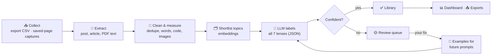
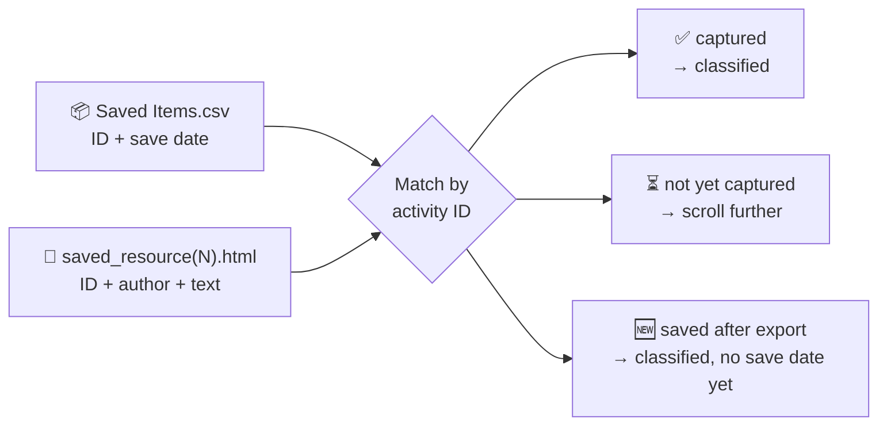
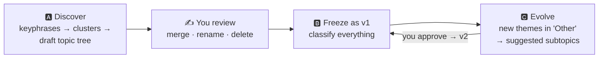
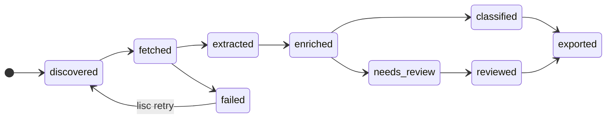

<h1 align="center">🗂️ LinkedIn Saved Content Classifier</h1>

<p align="center">
  <b>Turn your messy pile of saved LinkedIn posts and articles into an organised, searchable study library, built for AI Engineers.</b>
</p>

<p align="center">
  
  
  
  
  
</p>

<p align="center">
  <a href="#-quick-start">Quick start</a> •
  <a href="#-what-you-get">What you get</a> •
  <a href="#-how-it-works">How it works</a> •
  <a href="#-usage-guide">Usage</a> •
  <a href="#-configuration">Config</a> •
  <a href="#-faq">FAQ</a> •
  <a href="./HLD.md">HLD</a> •
  <a href="./LLD.md">LLD</a>
</p>

---

> [!NOTE]
> This README describes the **target product** defined in the design docs ([HLD](./HLD.md), [LLD](./LLD.md)). Commands and file names match the planned implementation, so you can build against them directly.

## 📑 Contents

- [Why this exists](#-why-this-exists)
- [What you get](#-what-you-get)
- [How it works](#-how-it-works)
- [Quick start](#-quick-start)
- [Installation](#-installation)
- [Getting your saved items in](#-getting-your-saved-items-in)
- [🆕 First run: discover your topics](#-first-run-discover-your-topics)
- [🆕 Running fully local with Ollama](#-running-fully-local-with-ollama)
- [Usage guide](#-usage-guide)
- [The dashboard](#-the-dashboard)
- [Configuration](#-configuration)
- [Customising topics and scoring](#-customising-topics-and-scoring)
- [Exports](#-exports)
- [Measuring accuracy](#-measuring-accuracy)
- [Cost and privacy](#-cost-and-privacy)
- [Project structure](#-project-structure)
- [Troubleshooting](#-troubleshooting)
- [FAQ](#-faq)
- [Roadmap](#-roadmap)
- [Contributing](#-contributing)
- [License and disclaimer](#-license-and-disclaimer)

---

## 💡 Why this exists

LinkedIn's **Saved** list is where good content goes to be forgotten: no folders, no search, no way to tell a 3-minute post from a 3-day project.

This tool reads every item you've saved and gives it a **library card**, so you can ask questions like:

- 🎯 *"Show me the most relevant RAG content I can finish in under an hour."*
- 🧗 *"What's beginner-friendly in Agents, ordered from easy to hard?"*
- 🧪 *"List every interview-question set I've saved."*
- 🗓️ *"I have 3 hours this Saturday. Plan my study session."*

---

## 🎁 What you get

Every saved post or article is labelled across **7 lenses**:

| # | Lens | Values |
|---|---|---|
| 1 | 🏷️ **Topic** | e.g. `RAG`, `Agents & Tool Use`, `Evaluation`, `LLMOps`, … ([full list](#-customising-topics-and-scoring)) |
| 2 | 🔖 **Subtopic** | e.g. `RAG › Chunking strategies` |
| 3 | 📶 **Difficulty** | `Beginner` · `Intermediate` · `Advanced` · `Expert` |
| 4 | ⏱️ **Time** | **(a)** to *cover* it once · **(b)** to *understand* it properly |
| 5 | 🧩 **Content type** | `Tutorial` · `Mini-project` · `Full project` · `Interview Q set` · `News` · `Misc` |
| 6 | 🎯 **AI Engineer alignment** | `0.0 – 10.0`, with a breakdown of *why* |
| 7 | 📝 **Summary** | One paragraph: what it says **and** why the author posted it |

<details>
<summary>👀 <b>See a sample output row</b></summary>

| Title | Topic › Subtopic | Level | Cover / Understand | Type | AI-Eng | Summary |
|---|---|---|---|---|---|---|
| *Stop using fixed-size chunks…* | RAG › Chunking | Intermediate | 20 m / 1 h 30 m | Tutorial | **8.7** | Explains why naive chunking hurts retrieval and demonstrates semantic chunking in Python; written to educate, with a soft plug for the author's newsletter. |
| *Top 40 GenAI interview Qs* | Career › Interview prep | Intermediate | 35 m / 4 h | Interview Q set | **7.4** | A list of common GenAI interview questions with brief answers… |
| *New open-weights model released* | Industry › Releases | Beginner | 5 m / 5 m | News | **5.1** | Announces a model release and its benchmark claims… |
</details>

**Plus:**
- 📊 A local **dashboard** to filter, sort, search and plan
- ✍️ A **review queue** where your corrections **teach the system**
- 📤 **Exports** to CSV, JSON, Obsidian Markdown and Notion
- 🧪 A built-in **accuracy report** so changes are measured, not guessed
- 🔒 **Local-first.** It can even run fully offline with a local model

---

## ⚙️ How it works



<details>
<summary>🤔 <b>Why it's accurate and cheap (short version)</b></summary>

1. **Fixed topic list.** The AI picks from your taxonomy and can't invent labels.
2. **Shortlist first.** Fast embeddings narrow ~40 subtopics down to 5 good candidates.
3. **One call per item.** All 7 lenses are filled in a single structured response.
4. **Maths for time.** Word, code and image counts give a reliable baseline, and the AI can only adjust it within limits.
5. **Explainable scores.** The AI-Engineer score is a weighted sum of 6 sub-scores.
6. **Learns from you.** Your corrections become examples in future prompts.
7. **Never pays twice.** Results are cached by content + prompt + model + taxonomy version.

Read more in the [HLD](./HLD.md#7--how-the-smart-part-works) and [LLD §9](./LLD.md#9-algorithms).
</details>

---

## 🚀 Quick start

> ⏱️ About 5 minutes from zero to your first labelled items.

```bash
# 1. Get the code
git clone https://github.com/<you>/linkedin-saved-classifier.git
cd linkedin-saved-classifier

# 2. Install (uv recommended)
uv sync                       # or: pip install -e .

# 3. Local models (default: nothing leaves your machine). Install Ollama from https://ollama.com, then:
ollama pull qwen3:8b
ollama pull nomic-embed-text
#    (Prefer a cloud API instead? cp .env.example .env, add your key, and set llm.provider in config.yaml)

# 4. Initialise database + seed taxonomy, and check setup
uv run lisc init
uv run lisc doctor

# 5. 🔄 Get your saved posts in (by hand; see "Getting your saved items in")
#    a) LinkedIn → Settings → Data privacy → Get a copy of your data → tick Saved Items
#       (arrives within 48 h) → unzip into ./linkedin_export/
#    b) Open My items → Saved posts, scroll, press Ctrl+S → "Webpage, Complete"
#       → save into ./data/captures/   (repeat every few hundred posts)

# 6. Load both, merge them, then prepare the text (no labels yet)
uv run lisc ingest --source export  --path ./linkedin_export/
uv run lisc ingest --source capture --path ./data/captures/
uv run lisc coverage                  # e.g. "674 of 4,300 captured"
uv run lisc process --stage extract,enrich

# 7. Discover your topics, review the draft, approve it
uv run lisc taxonomy discover
#    → edit taxonomy/taxonomy.draft.yaml (merge / rename / delete)
uv run lisc taxonomy approve taxonomy/taxonomy.draft.yaml

# 8. Classify and look
uv run lisc process --stage classify
uv run lisc dashboard         # opens http://localhost:8501
```

> 💡 With fewer than ~100 items, skip step 7: the seed topic list is used, and new topics get suggested over time.
>
> 🆕 You **don't need to capture everything first**. Classify what you have (e.g. your most recent year), and add older captures later. Already-classified posts are skipped automatically.

🎉 You should now see your items, fully labelled, in the dashboard.

---

## 📦 Installation

### Requirements

| Need | Version | Notes |
|---|---|---|
| Python | 3.11+ | |
| uv *(or pip)* | latest | `pip install uv` |
| An LLM | — | **[Ollama](https://ollama.com) installed locally (recommended default)**, or an Anthropic / OpenAI API key |
| GPU *(optional)* | NVIDIA with ≥ 6 GB VRAM | Not required, but makes local models several times faster |
| Disk | ~1 GB + models | Embedding model, Ollama models (~23 GB for the recommended set), and your page captures (a few MB each) |

### Optional extras

```bash
uv sync --extra notion      # Notion export
uv sync --extra server      # FastAPI + Postgres support
uv sync --extra dev         # tests, linting
```

<details>
<summary>🐳 <b>Docker (server mode)</b></summary>

```bash
cp .env.example .env        # set keys + LISC_API_TOKEN
docker compose up -d        # api + worker + postgres(pgvector) + dashboard
```

| Service | URL |
|---|---|
| Dashboard | http://localhost:8501 |
| REST API | http://localhost:8000/docs |
</details>

---

## 📥 Getting your saved items in

🔄 LinkedIn has **no API for saved items**, and its User Agreement prohibits bots, scrapers and browser extensions that copy content, whether logged in or not. So **this tool never opens linkedin.com**. Instead, you make two kinds of files by hand, and the tool joins them offline:

| | 📦 **Data export** | 💾 **Saved-page captures** |
|---|---|---|
| What it is | `Saved Items.csv` from LinkedIn's "Download your data" | Copies of your Saved posts page made with **Ctrl+S** while scrolling |
| What it gives | The **complete list**: one URL per saved post + the **date you saved it** | Each post's **author, headline, full text, attached link title** |
| What it lacks | Any content (no author, no text, no title) | Save dates; only covers what you scrolled past |
| Role | The **checklist** | The **content** |
| Command | `lisc ingest --source export --path ./linkedin_export/` | `lisc ingest --source capture --path ./data/captures/` |

They're matched by the **activity ID**: the long number in every post URL (`…/feed/update/urn:li:activity:7520913254760472576`). The same number is written on each post card in your saved page. The tool reads it as **plain text**, so no URL is ever opened.



<details open>
<summary>📦 <b>Step 1: Request the data export</b></summary>

1. LinkedIn (desktop) → **Me → Settings & Privacy → Data privacy → Get a copy of your data**.
2. Choose **"Want something in particular?"**, tick **Saved Items**, and click **Request archive**.
3. LinkedIn emails a download link, usually within minutes but **up to 48 hours**. The link expires after **72 hours**.
4. Unzip it into `./linkedin_export/`. The file you need is `Saved Items.csv`:

```csv
savedItem,CreatedTime
https://www.linkedin.com/feed/update/urn:li:activity:7520913254760472576,30-10-2026 13:50
```
- `CreatedTime` is when **you saved** the post, written **day first** (`30-10-2026` = 30 October).
- Every URL is a post (`feed/update/urn:li:activity:…`), with no title words, so this file alone can't be classified. That's why you also need captures.
</details>

<details open>
<summary>💾 <b>Step 2: Capture your Saved page (by hand)</b></summary>

1. **Free up memory:** close other tabs and, optionally, block images for linkedin.com (**Chrome/Edge → Site settings → Images → Don't allow**). Text, names and links still show.
2. Open **My items → Saved posts** and **scroll down by yourself**. The list goes from newest to oldest saves.
3. Every **few hundred posts** (or whenever the tab feels slow), press **Ctrl+S** and choose **"Webpage, Complete"**. Name it `Saved Posts _ LinkedIn_01`, `_02`, … and save into `./data/captures/`. **Keep the tab open and keep scrolling** after each save.
4. Each save contains **everything loaded so far**, so the newest one is the most complete; older ones are crash backups.
5. Stop whenever you like. You can classify what you have and capture older posts later.

**What gets saved, and which file matters**

```text
data/captures/
├── Saved Posts _ LinkedIn_02.html          ← main page (home feed + a pointer)
└── Saved Posts _ LinkedIn_02_files/
    ├── saved_resource(3).html              ← ⭐ YOUR SAVED POSTS (the largest one)
    ├── saved_resource(2).html, (4)…        ← ads / tracking (ignored)
    └── *.js, images                        ← ignored
```

- LinkedIn shows the Saved list inside an embedded frame, so the posts are in **`saved_resource(N).html`**, not the main file.
- **N changes between saves.** You don't need to pick: point the tool at the folder and it finds the right file. To check by eye, it's the **largest** `saved_resource` file, and opening it shows only your saved posts.
- Keep each main `.html` file **together with** its `_files` folder.
</details>

<details>
<summary>📝 <b>Manual list: small top-ups</b></summary>

For a handful of posts saved after your last export, list their URLs:

```text
https://www.linkedin.com/feed/update/urn:li:activity:7521828520826888192
```
```bash
lisc ingest --source manual --file urls.txt
```
A URL alone has no content, so these posts get classified once they appear in a capture.
</details>

<details>
<summary>📊 <b>Checking coverage</b></summary>

```bash
lisc coverage
```
```text
# example output
export rows      : 4,300
captured         : 674  (16%)
not yet captured : 3,626
saved after export: 0
captured saves   : 05-11-2025 → 30-10-2026
```
- **not yet captured** → scroll further back next time.
- After you've scrolled to the very bottom, `lisc coverage --mark-unavailable` marks posts that never appeared (usually deleted or made private by their authors).
</details>

<details>
<summary>🔗 <b>What about links inside posts?</b></summary>

- Links to normal websites (GitHub, blogs, docs) may be fetched and read.
- **`lnkd.in` short links are not opened automatically**, because that would mean automated requests to LinkedIn. The post is classified from its own text and the attached link's title (e.g. "GitHub - user/repo · github.com"). The link is kept, so you can open it yourself.
</details>

<details>
<summary>🛠️ <b>Standalone scripts (usable today)</b></summary>

The capture parser and merge exist as tested scripts you can run before the full tool is built:

```bash
# parse captures (frame files, main pages or a folder) → one row per unique post
python scripts/parse_saved.py posts_parsed.csv "data/captures/"

# join with the export → adds saved_at + status, prints a coverage report
python scripts/merge_export.py "linkedin_export/Saved Items.csv" posts_parsed.csv posts_merged.csv
```
Output columns: `activity_id, post_url, post_date_utc, relative_time, author, author_headline, text, text_clean, word_count, char_count, urls, url_count, attachment_title, attachment_site, has_image, source_file` (+ `saved_at, status` after merging).
</details>

---

## 🔎 First run: discover your topics

**Don't know what you've saved? You don't need to.** Instead of guessing a topic list up front, the tool builds it **from your saved items**, and you approve it.



| Phase | Command | What you do |
|---|---|---|
| 🅰️ **Discover** | `lisc taxonomy discover` | Open `taxonomy/taxonomy.draft.yaml` and `data/discovery_report.md`. Each topic shows its **item count** and sample titles. Merge, rename, split, or delete |
| 🅱️ **Freeze** | `lisc taxonomy approve taxonomy/taxonomy.draft.yaml` | Nothing. The tree becomes `v1`, and classification uses it |
| 🅲 **Evolve** | `lisc taxonomy suggest` | Approve or reject proposed new subtopics when "Other" grows |

<details>
<summary><b>How discovery works, and tips</b></summary>

- A small LLM call writes 3–5 **keyphrases** per item. Items are then **embedded** and **clustered**, so similar content groups together.
- Clusters that match the built-in **seed list** keep its names. New clusters get names from the LLM. Seed topics with almost no items are removed.
- Subtopics are grouped into **8–15 topics** (max 6 subtopics each).
- Works best with **≥ 100 items**. With fewer, the seed list is used and Phase C fills the gaps over time.
- Only **topics and subtopics** are discovered. Difficulty, type, time and the AI-Engineer score use fixed rubrics.
- Want your own starting point? Edit `taxonomy/seed.yaml` before discovering, or run `lisc taxonomy discover --seed my_seed.yaml`.
</details>

---

## 🦙 Running fully local with Ollama

This is the **default setup**: the language model and the embedding model both run on your computer, so no AI company sees your content and there's no cost per item.

### Recommended models (16 GB RAM · 6 GB VRAM laptop)

| Role | Pull command | Size | Notes |
|---|---|---|---|
| ⭐ Classifier | `ollama pull qwen3:8b` | ~5 GB | Best all-rounder at this size; fits a 6 GB GPU almost fully |
| Challenger | `ollama pull gemma3:12b` | ~8 GB | Great summaries; best non-Chinese option |
| Hard items | `ollama pull qwen3:14b` | ~9 GB | Used automatically for low-confidence items; slower |
| Fast option | `ollama pull qwen3:4b` | ~2.5 GB | Fastest; a little less accurate |
| ⭐ Embeddings | `ollama pull nomic-embed-text` | ~0.3 GB | Upgrade option: `qwen3-embedding:0.6b` |

> Exact tags and sizes change over time, so check the Ollama library. Rough speed with `qwen3:8b` on this laptop is ~5–15 s per item, so 500 items take about 1–2 hours once, and only new items after that.

<details>
<summary><b>❓ Common questions about local models</b></summary>

- **Is there a newer Llama I should use instead of Llama 3.1 8B?** Not at this size. Llama 4 models are far too large for a laptop, and Llama 3.2 comes only in 1B and 3B. Qwen3 and Gemma 3 are generally stronger than Llama 3.1 8B here.
- **Is a Chinese model (Qwen) safe?** When run locally, the model is just a file on your disk with no connection to its maker. The licence is Apache 2.0. Prefer non-Chinese? Use `gemma3:12b`.
- **Can I install several models?** Yes, as many as your disk allows. Only the one in use occupies RAM or VRAM. Ollama loads it on demand and unloads it after a few idle minutes.
- **Can local models search the web or use tools?** Not by themselves. A model only generates text; "tool support" means it can *ask* an app to run a tool. This tool gives the classifier **no tools**: it fetches articles itself, and the model only returns labels.
- **Which model should I keep?** Label ~50 items, then compare: `lisc eval --model qwen3:8b` vs `lisc eval --model gemma3:12b`.
</details>

<details>
<summary><b>⚙️ Settings for a 6 GB GPU</b></summary>

```yaml
llm:
  provider: ollama
  model: qwen3:8b
  escalate_model: qwen3:14b
  ollama: { host: "http://127.0.0.1:11434", num_ctx: 8192, keep_alive: 30m, think: false }
embeddings: { provider: ollama, model: nomic-embed-text, dim: 768 }
concurrency: { llm: 1 }
```
- Run `ollama ps` during a run. The 8B model should show close to **100% GPU**.
- Close games or GPU-heavy apps while processing.
- Changing the embedding model? Update `dim`, then run `lisc reembed`.
</details>

### 🔒 Local privacy checklist

Local models remove the biggest risk (sending content to an AI provider), but "local" is **not automatically 100% safe**:

- [ ] Ollama listens only on `127.0.0.1` (never set `OLLAMA_HOST=0.0.0.0`), and the port isn't forwarded. **Its API has no password.**
- [ ] You use only models you've pulled locally, not Ollama's cloud-hosted models or web search.
- [ ] Models come from official library names, not unknown uploads.
- [ ] Ollama and this tool are kept up to date.
- [ ] `data/` and your page captures are **not** inside OneDrive or Google Drive synced folders. 🔄 Captures contain your name and account page data, so never share them publicly.
- [ ] Disk encryption (BitLocker) and a screen lock are on.
- [ ] You know that fetching articles still uses the internet, like your browser does.

`lisc doctor` checks the first two items and the synced-folder item for you.

---

## 🧭 Usage guide

### The everyday flow

```bash
lisc run              # collect from configured sources + process everything new
lisc review           # fix anything the system wasn't sure about
lisc dashboard        # browse, filter, plan
```

### All commands

<details open>
<summary><b>📋 Command reference</b></summary>

| Command | What it does |
|---|---|
| `lisc init` | Create DB, copy default taxonomy and rubrics, embed topics |
| `lisc ingest --source export\|capture\|manual` | 🔄 Load the export list, parse page captures, or add a few URLs |
| `lisc coverage [--missing out.csv] [--mark-unavailable]` | 🆕 Captured vs missing posts, and the save-date range reached |
| `lisc process [--stage …] [--limit N]` | Run fetch → extract → enrich → classify |
| `lisc run` | `ingest` + `process` in one go |
| `lisc retry` | Retry items that failed |
| `lisc reclassify [--where …] [--force]` | Re-label items (e.g. after changing the taxonomy) |
| `lisc review` | Open the Review tab |
| `lisc dashboard` | Open the dashboard |
| `lisc export --format csv\|json\|obsidian\|notion` | Export your library |
| `lisc eval --gold data/gold.jsonl` | Accuracy report |
| `lisc eval --compare <runA> <runB>` | Compare two prompt or model versions |
| `lisc taxonomy validate\|show\|diff\|suggest` | Manage topics |
| `lisc taxonomy discover [--seed PATH]` | 🆕 Draft a topic tree from your saved items (Phase A) |
| `lisc taxonomy approve <file>` | 🆕 Freeze a reviewed draft as the active taxonomy (Phase B) |
| `lisc reembed` | 🆕 Re-embed everything after switching embedding model |
| `lisc doctor` | 🆕 Check Ollama, models, privacy settings and config |
| `lisc stats` | Counts, review rate, tokens and estimated cost |

Add `--help` to any command for its options.
</details>

<details>
<summary>🍳 <b>Recipes</b></summary>

**Process only 20 items to test a new prompt**
```bash
lisc process --stage classify --limit 20
```

**Re-label everything in RAG after editing its subtopics**
```bash
lisc taxonomy validate
lisc reclassify --where "topic_id = 'rag'"
```

**Try a different model without losing old results**
```bash
lisc reclassify --model <other-model-id> --limit 50
lisc eval --compare last previous
```

**Fully offline run**
```bash
ollama pull <local-model>
LISC_LLM__PROVIDER=ollama LISC_LLM__MODEL=<local-model> lisc process
```
</details>

### Item lifecycle



---

## 📊 The dashboard

```bash
lisc dashboard   # → http://localhost:8501
```

| Tab | What you can do |
|---|---|
| 📚 **Library** | Filter by topic tree, difficulty, type, score and time; semantic search ("vector DB tuning"); card or table view; mark items done |
| 🟡 **Review** | See low-confidence items one at a time; fix any field or approve with one click; read the AI's reasoning |
| 🗓️ **Planner** | Enter "I have **120** minutes for **Agents**" and get the best-value items, ordered easy → hard |
| 📈 **Insights** | Items per topic, difficulty mix, score distribution, total backlog hours, "Other" rate |
| ⚙️ **Runs** | History, tokens, cost, failures with one-click retry |

> [!TIP]
> Every fix in the Review tab is saved as a **golden example**. Similar future items are labelled the way *you* would, with no retraining.

---

## 🛠️ Configuration

Settings come from (highest priority first): **CLI flags → environment variables → `config.yaml` → defaults.**

<details open>
<summary><b>🔑 <code>.env</code></b></summary>

```dotenv
ANTHROPIC_API_KEY=        # if provider = anthropic
OPENAI_API_KEY=           # if provider = openai
NOTION_TOKEN=             # for Notion export
NOTION_DB_ID=
LISC_LOG_LEVEL=INFO
```
</details>

<details>
<summary><b>⚙️ Most useful <code>config.yaml</code> settings</b></summary>

| Key | Default | Meaning |
|---|---|---|
| `llm.provider` | `ollama` | `ollama` (local), `anthropic` or `openai` |
| `llm.model` | `qwen3:8b` | Model used for bulk labelling |
| `llm.escalate_model` | `qwen3:14b` | Used automatically for hard or uncertain items |
| `llm.ollama.host` | `http://127.0.0.1:11434` | Keep on localhost |
| `llm.ollama.num_ctx` | `8192` | Context window; keep modest on a 6 GB GPU |
| `llm.escalate_below` | `0.45` | Confidence below which to escalate |
| `llm.max_input_tokens` | `6000` | Long content is smart-truncated to this |
| `embeddings.model` | `nomic-embed-text` | Embedding model (via Ollama) |
| `embeddings.dim` | `768` | Must match the embedding model |
| `discovery.min_items` | `100` | Below this, discovery falls back to the seed list |
| `discovery.max_topics` | `15` | Cap on discovered topics |
| `classification.shortlist_k` | `5` | Topic candidates shown to the LLM |
| `classification.fewshot_n` | `3` | Your past corrections included as examples |
| `classification.review_threshold` | `0.60` | Below this → Review queue |
| `time.reading_wpm` | `230` | Reading speed for normal text |
| `time.technical_wpm` | `180` | Reading speed for code- or math-heavy text |
| `concurrency.llm` | `1` | Parallel LLM calls (1 for Ollama on a laptop GPU; 4 for cloud APIs) |
| `rate_limit.llm_rpm` | `50` | Max LLM requests per minute |
| `batch.enabled` | `false` | Use the provider's cheaper batch API for big back-fills |
| `privacy.redact_emails_phones` | `true` | Mask contact details before sending to the LLM |
| `database_url` | `sqlite:///data/lisc.db` | Use `postgresql+psycopg://…` for server mode |

Full reference: [LLD §12](./LLD.md#12-configuration).
</details>

---

## 🎨 Customising topics and scoring

All labelling rules live in two plain YAML files. **Edit them, then run `lisc reclassify`.**

> 🆕 Your first taxonomy normally comes from [discovery](#-first-run-discover-your-topics). The table below is the **seed list** discovery starts from.

### 🌳 Topics: `taxonomy/taxonomy.v1.yaml`

<details>
<summary><b>Default topics (click to expand)</b></summary>

| Topic | Example subtopics |
|---|---|
| LLM Fundamentals | Transformer architecture · Pre/post-training · Inference & decoding |
| Prompt & Context Engineering | Techniques · Structured output · Context management |
| RAG | Chunking · Embeddings & vector DBs · Retrieval & re-ranking · Advanced RAG |
| Agents & Tool Use | Tool calling / MCP · Agent frameworks · Multi-agent systems |
| Fine-tuning & Adaptation | LoRA / PEFT · Training data |
| Evaluation & Testing | LLM-as-judge · Benchmarks · Safety & guardrails |
| LLMOps & Deployment | Serving & scaling · Observability · Cost & latency |
| ML & Math Foundations | Classical ML · Deep learning · Math & stats |
| Software Engineering for AI | Python & tooling · System design · Data engineering |
| Career & Interviews | Interview prep · Roadmaps · Jobs |
| AI Industry & News | Releases · Research papers · Policy & ethics |
| Other | General / off-topic |
</details>

```yaml
- id: rag
  name: Retrieval-Augmented Generation (RAG)
  description: Grounding LLMs on external knowledge via retrieval.
  subtopics:
    - id: rag.reranking
      name: Retrieval & re-ranking
      description: hybrid search, BM25, cross-encoders   # ← good descriptions = good labels
```

> 💡 **Let the system suggest new topics:** `lisc taxonomy suggest` groups items stuck in "Other" and proposes new subtopics for you to approve.

### 📏 Rubrics: `taxonomy/rubrics.yaml`

- **Difficulty:** definitions and examples for each of the 4 levels.
- **Content type:** ordered decision rules (the first match wins).
- **AI-Engineer alignment:** 6 criteria with weights (default below):

| Criterion | Weight | Asks… |
|---|---|---|
| Applicability | 30% | Can I use this directly when building LLM apps? |
| Technical depth | 20% | Is it substantive, or buzzwords? |
| Hands-on | 20% | Is there something to build or run? |
| Currency | 10% | Is it modern and still relevant? |
| Career value | 10% | Does it help with interviews or portfolio? |
| Production relevance | 10% | Does it cover evals, cost, latency, reliability? |

> 🎯 **Different role?** Change `role_profile`, the weights and the topics (e.g. for *Data Engineer* or *ML Researcher*), then `lisc reclassify`.

---

## 📤 Exports

```bash
lisc export --format csv      --out exports/library.csv
lisc export --format json     --out exports/library.json
lisc export --format obsidian                 # one note per item + topic index notes
lisc export --format notion                   # needs NOTION_TOKEN + NOTION_DB_ID
```

<details>
<summary>🟣 <b>Example Obsidian note</b></summary>

```markdown
---
topic: RAG
subtopic: Chunking strategies
difficulty: intermediate
content_type: tutorial
time_cover_min: 20
time_understand_min: 90
ai_engineer_score: 8.7
source: https://www.linkedin.com/posts/...
saved_at: 2026-09-14
tags: [linkedin, rag, rag/chunking]
---
# Stop using fixed-size chunks in your RAG pipeline

Explains why naive fixed-size chunking hurts retrieval quality and walks through
semantic and structure-aware chunking with Python examples…
```
</details>

---

## 🧪 Measuring accuracy

1. Review (or hand-label) ~100 items in the **Review** tab. They are appended to `data/gold.jsonl` automatically.
2. Run:
   ```bash
   lisc eval --gold data/gold.jsonl
   ```
3. You get a report like this:

| Lens | Metric | Target |
|---|---|---|
| Topic | Accuracy | ≥ 85% |
| Subtopic | Accuracy | ≥ 70% |
| Difficulty | Within ±1 level | ≥ 90% |
| Content type | Accuracy | ≥ 85% |
| Time | Correct bucket | ≥ 70% |
| AI-Eng score | Mean abs. error | ≤ 1.5 |
| Summary | Judge score (1–5) | ≥ 4.2 |

Always run `lisc eval` **before** adopting a new prompt, model or taxonomy.

---

## 💰 Cost and privacy

| | |
|---|---|
| 💵 **Cost** | About **one LLM call per item** (~2–4k tokens). Items are cached, so re-runs on unchanged items are free. `lisc stats` shows estimated spend; set your provider's current prices in `config.yaml → pricing` |
| 🧮 **Save more** | Use a fast or small model for bulk work, enable `batch.enabled` for large back-fills, and keep local embeddings |
| 🔒 **Privacy** | Everything is stored locally in `data/`. With the default Ollama setup, no content leaves your machine (see the [local privacy checklist](#-local-privacy-checklist)). If you switch to a cloud API, only cleaned content is sent, with emails and phone numbers redacted |
| 🔑 **Secrets** | Live only in `.env`, which is git-ignored and never logged |

---

## 🗃️ Project structure

```text
linkedin-saved-classifier/
├── config.yaml              # behaviour
├── .env                     # secrets (git-ignored)
├── taxonomy/                # topics + rubrics (edit me!)
├── prompts/                 # versioned prompt templates
├── src/lisc/
│   ├── collect/             # export, capture (saved pages), manual, merge
│   ├── extract/             # post, article, PDF
│   ├── normalize/ enrich/   # cleaning, dedup, metrics
│   ├── classify/            # shortlist, prompts, LLM call, validation, scoring
│   ├── llm/                 # Anthropic / OpenAI / Ollama adapters
│   ├── store/               # DB + vectors
│   ├── pipeline/            # runner, caching, state machine
│   ├── review/ export/ eval/
│   ├── api/                 # optional FastAPI
│   └── ui/                  # Streamlit dashboard
├── scripts/                 # 🆕 parse_saved.py, merge_export.py (standalone)
├── data/                    # DB, gold set, exports, captures/ (git-ignored)
└── tests/
```

Deep dive: [LLD §2](./LLD.md#2-repository-layout).

---

## 🩺 Troubleshooting

<details>
<summary><b>Many items are marked <code>partial</code></b></summary>

The article was behind a login or paywall, so the item is labelled from the post text only. Options: accept the lower confidence and review those items, or open the article yourself.
</details>

<details>
<summary><b>Too many items land in "Other"</b></summary>

Your taxonomy is missing a theme. Run `lisc taxonomy suggest`, approve the new subtopics, then `lisc reclassify --where "topic_id='other'"`.
</details>

<details>
<summary><b>HTTP 429 / rate-limit errors</b></summary>

Lower `concurrency.llm` and `rate_limit.llm_rpm`, then `lisc retry`.
</details>

<details>
<summary><b>🔄 "No post cards found" in a capture</b></summary>

- You probably pointed at the **main** `.html` without its `_files` folder. Keep them together, or point at the folder.
- You may have saved with "Webpage, HTML only". Use **"Webpage, Complete"**.
- If both are fine, LinkedIn may have changed its page structure: update `collectors.capture.card_selector` in `config.yaml`.
</details>

<details>
<summary><b><code>database is locked</code> (SQLite)</b></summary>

Close other processes using `data/lisc.db` (e.g. a second dashboard). WAL mode is on by default. For heavy parallel use, switch to Postgres.
</details>

<details>
<summary><b>Time estimates feel off</b></summary>

Adjust `time.reading_wpm` / `time.technical_wpm` to your own pace, and correct a few items in Review. The planner adapts.
</details>

---

## ❓ FAQ

<details>
<summary><b>Does this need the LinkedIn API?</b></summary>
No. LinkedIn doesn't offer one for saved items. 🔄 You provide the official data export (the list) and pages you save yourself with Ctrl+S (the content). The tool never connects to LinkedIn.
</details>

<details>
<summary><b>🆕 Why can't the tool just scroll LinkedIn for me?</b></summary>
LinkedIn's User Agreement prohibits bots, scrapers and browser extensions that copy content, logged in or not, and that includes auto-scrolling and automatic screenshots or page saves. Breaking it can get your account restricted. So the only LinkedIn-facing steps are ones you do by hand; everything after that is automated and offline.
</details>

<details>
<summary><b>🆕 Is the export CSV still needed if captures have all the text?</b></summary>
Yes. It's the only complete list of what you saved, and the only source of save dates. It tells you exactly which posts are still missing from your captures.
</details>

<details>
<summary><b>🆕 How do I get the post's date?</b></summary>
Two dates are kept: the <b>save date</b> (from the export) and the <b>publish date</b>, which is decoded from the activity ID itself, with no internet needed.
</details>

<details>
<summary><b>Do I have to write the topic list myself?</b></summary>
No. Run <code>lisc taxonomy discover</code>. It groups your saved items and drafts the topic list, and you just review and approve it. New themes are suggested later from the "Other" bucket.
</details>

<details>
<summary><b>Can I use it without paying for an AI API?</b></summary>
Yes. Set <code>llm.provider: ollama</code> and use a local model. It's slower and a little less accurate, but completely free and private.
</details>

<details>
<summary><b>What is the difference between "time to cover" and "time to understand"?</b></summary>
<b>Cover</b> = going through it once (reading, watching, running the code shown). <b>Understand</b> = being able to explain and reuse it, which includes practice, re-reading and building. Understanding always takes at least as long as covering.
</details>

<details>
<summary><b>Why is my AI-Engineer score different from what I expected?</b></summary>
Open the item. The score is a weighted sum of 6 sub-scores, each with a one-line reason. Fix it in Review, or change the weights in <code>rubrics.yaml</code>.
</details>

<details>
<summary><b>Will my old labels be lost if I change the taxonomy?</b></summary>
No. Every classification is versioned. Old labels stay in history, and new ones become active after <code>lisc reclassify</code>.
</details>

<details>
<summary><b>Can I adapt this for X/Twitter bookmarks, Pocket or browser bookmarks?</b></summary>
Yes. Add a new <code>Collector</code> class (see <a href="./LLD.md#20-extension-points">LLD §20</a>). Everything downstream works unchanged.
</details>

---

## 🛣️ Roadmap

- [x] Architecture: HLD + LLD
- [ ] **v0.1** 🔄 Export + saved-page capture collectors, merge by activity ID, coverage report, SQLite
- [ ] **v0.2** Taxonomy discovery (Phases A/B/C) + Ollama-first classifier: shortlist, LLM, validation, cache
- [ ] **v0.3** Dashboard: Library + Review, CSV/Obsidian export
- [ ] **v0.4** Eval suite, few-shot learning from corrections
- [ ] **v0.5** Planner, Insights, Notion export, model escalation
- [ ] **v1.0** 🔄 Taxonomy suggestions, server mode (Docker)
- [ ] **Later** OCR for image carousels, video transcripts, more sources

---

## 🤝 Contributing

```bash
uv sync --extra dev
uv run pre-commit install
uv run pytest -q            # unit + integration (uses a fake LLM, no API key needed)
uv run ruff check . && uv run mypy src/lisc/core src/lisc/classify
```

1. Fork → branch (`feat/my-change`) → PR.
2. If you change prompts, rubrics or the taxonomy, **include a `lisc eval` before/after table** in the PR.
3. Keep new modules behind the existing interfaces (`Collector`, `Extractor`, `LLMClient`, `VectorStore`).

---

## 📄 License and disclaimer

MIT License.

This project is **not affiliated with LinkedIn**. It is intended for organising **your own** saved content for personal use. You are responsible for complying with LinkedIn's User Agreement and with the copyright of the content you process.

<p align="center">Made for curious AI Engineers 🧠⚡ · <a href="./HLD.md">HLD</a> · <a href="./LLD.md">LLD</a></p>
